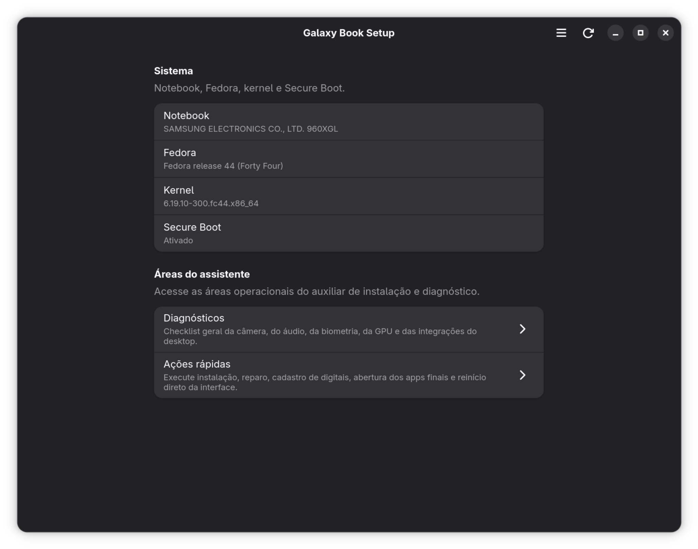
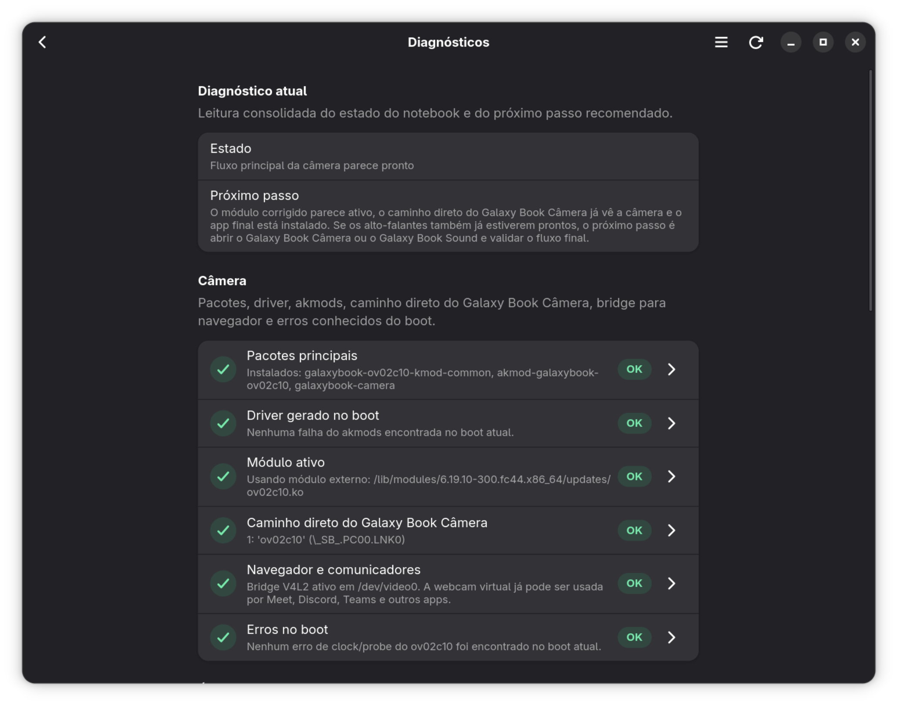
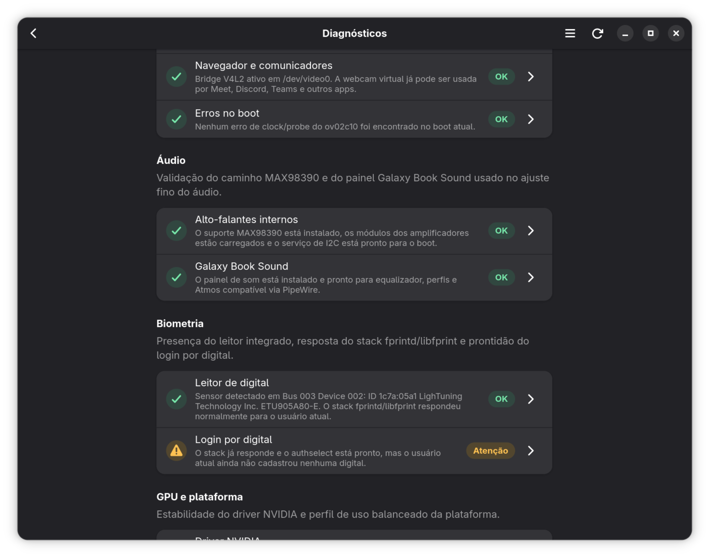
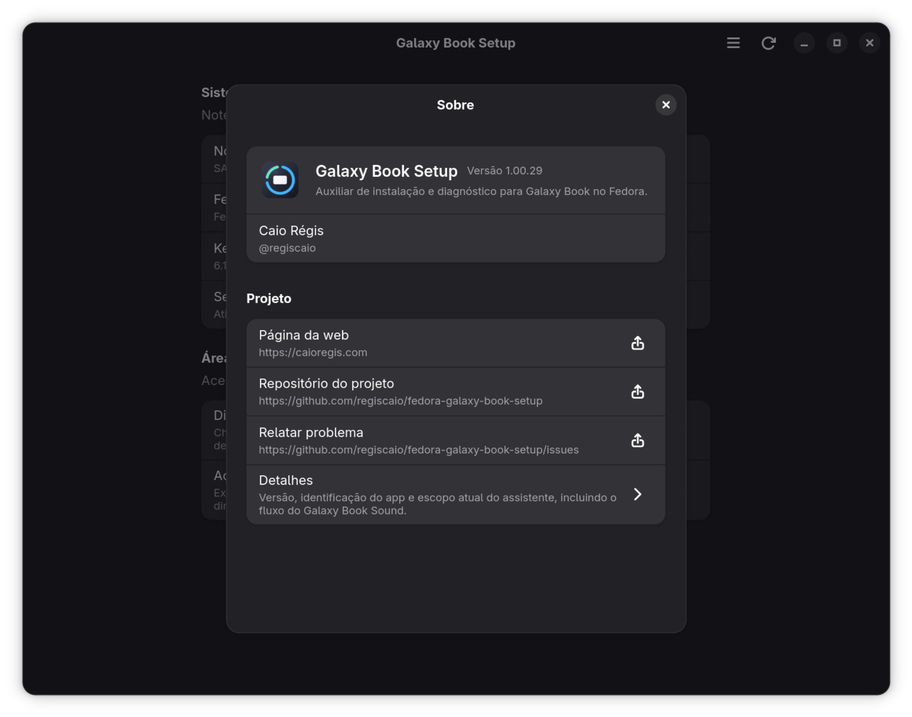

<p align="center">
  
</p>

<h1 align="center">Galaxy Book Setup</h1>

<p align="center">
  <a href="README.md">🇧🇷 Português</a> 
  <a href="README.en.md">🇺🇸 English</a> 
  <a href="README.es.md">🇪🇸 Español</a> 
  <a href="README.it.md">🇮🇹 Italiano</a>
</p>

## Quick install

To install the setup app from the public DNF repository:

```bash
sudo dnf config-manager addrepo --from-repofile=https://packages.caioregis.com/fedora/caioregis.repo
sudo dnf install galaxybook-setup
```

Once the repository is configured, the app itself can already install the
notebook's main support set through the `Install core support` quick action,
pulling in the camera app, the `OV02C10` driver, and `MAX98390` speaker
support. It can also offer the installation of `Galaxy Book Sound`, which
handles the equalizer, profiles, and compatible Atmos mode.

`Galaxy Book Setup` is an installation and diagnostics helper for Samsung
Galaxy Book laptops on Fedora. The goal of the app is to organize setup flows
that would otherwise end up scattered across terminal commands, logs, RPM
packages, and manual validation steps.

The initial focus is the **internal camera** of the Galaxy Book4 Ultra, but
the project already covers the **internal speakers with MAX98390**, as well as
GPU, fingerprint, platform profile, and broader system integrations.

## Current interface

### Home screen



### Diagnostics



### Internal audio



### `About` modal



## Scope

This app does not replace:

- the kernel driver;
- the final camera app;
- low-level tools such as `akmods`, `modinfo`, or `journalctl`.

Its role is to work as an **installation and validation assistant**, showing
the current state of the machine and organizing the next steps.

For audio, that means a clean split of responsibilities: `Galaxy Book Setup`
validates the internal-speaker path, organizes installation, and opens
`Galaxy Book Sound`, while equalization, profiles, and `compatible Atmos` stay
in the sound app.

## Relationship with the other repositories

This project works together with:

- <https://github.com/regiscaio/fedora-galaxy-book-ov02c10>
- <https://github.com/regiscaio/fedora-galaxy-book-max98390>
- <https://github.com/regiscaio/fedora-galaxy-book-camera>
- <https://github.com/regiscaio/fedora-galaxy-book-sound>

Responsibilities:

- `fedora-galaxy-book-ov02c10`: packaged `ov02c10` module for Fedora;
- `fedora-galaxy-book-max98390`: packaged internal speaker support through MAX98390;
- `fedora-galaxy-book-camera`: daily-use camera app;
- `fedora-galaxy-book-sound`: equalizer, profiles, and compatible Atmos app with its own PipeWire backend;
- `fedora-galaxy-book-setup`: installation, diagnostics, and workflow assistant.

## Current capabilities

The current app already organizes the interface into well-defined areas:

- `System`: notebook, Fedora, kernel, and Secure Boot summary;
- `Diagnostics`: global checklist showing the state of the camera, browser
  bridge, audio, `Galaxy Book Sound`, fingerprint reader, GPU, the `akmods`
  MOK key, and desktop integrations, including the GNOME dock used on this
  notebook;
- `Quick actions`: install, repair, and driver priority adjustments; browser
  webcam enablement; internal-speaker enablement; Secure Boot key
  preparation for `MOK`; `Galaxy Book Sound` installation and launch;
  fingerprint stack repair; fingerprint-login enablement; opening
  fingerprint enrollment; NVIDIA flow; balanced profile; dock profile
  reapply; reboot; and camera-app launch.

Inside `Diagnostics`, each row opens a **suggested actions** subsection. That
allows the user to open the most relevant fixes and validations for the
selected item without losing the main `Quick actions` page.

The app also exposes a summary of warnings and errors through desktop
notifications. In docks and extensions that support launcher counters, the app
icon can show the total number of diagnostics currently marked as `Warning` or
`Error`.

The checklist currently covers:

- main camera packages;
- generation via `akmods` and an external RPM payload for the running kernel
  and every installed `kernel-core` kernel;
- origin of the active `ov02c10` module;
- camera detection through the direct `libcamera` path used by `Galaxy Book
  Camera`;
- V4L2 bridge for browsers and communication apps;
- known boot errors;
- MAX98390/MX98390 internal-speaker path, requiring both external modules for
  each kernel, a persistent service with a `success` result, and all four final
  I2C bindings;
- presence of `Galaxy Book Sound`;
- presence of the integrated fingerprint reader;
- fingerprint-login readiness through `fprintd` and `authselect`;
- NVIDIA driver state and the note that `nvidia-smi` is optional;
- readiness of the `akmods` public key in `MOK` when Secure Boot is enabled,
  without treating a key that the unprivileged user cannot read as absent;
- platform usage profile, with `balanced` highlighted as the recommended
  default;
- `Dash to Dock` state, including validation of the dock profile used on this
  notebook;
- GNOME extensions such as clipboard history, GSConnect, and desktop icons.

Quick actions do not just copy commands: they execute the main flows directly
through the interface, requesting administrative privilege when needed.

Today, the available actions include:

- installing the notebook's main support directly from setup, bringing in the
  camera app, the `OV02C10` driver, and `MAX98390` speaker support;
- installing the camera's main stack;
- rebuilding and validating the `OV02C10` driver with `akmods` for every
  installed kernel;
- reconciling `ov02c10` per kernel, requiring an external payload with the
  expected RPM owner and matching `vermagic`, without unloading or replacing
  an in-use module live;
- adjusting priority for the fixed driver only after every replacement has
  been validated. Package-owned helpers remove only recognized legacy shadows
  and overrides, run `depmod`, rebuild every initramfs, and use `lsinitrd` to
  confirm that each image contains the module from
  `extra/galaxybook-ov02c10`;
- enabling browser camera support through `icamerasrc`, `v4l2-relayd`, and
  `v4l2loopback`, while preserving vendor or administrator configuration and
  symlinks, keeping direct `libcamera` access, and requiring a virtual webcam
  with capture capability before reporting success. If the legacy
  administrator rule `/etc/udev/rules.d/90-hide-ipu6-v4l2.rules` exists, setup
  preserves it and stops before reloading UDev or services; review it and, if
  appropriate, remove it manually as an administrator before running the
  action again;
- enabling internal-speaker support through `MAX98390`, generating both
  packaged modules for each kernel, validating their RPM ownership, and
  enabling the I2C service that succeeds only when all four amplifiers are
  bound;
- preparing the Secure Boot key for `akmods`, generating the local key,
  creating the import request in `MOK`, and leaving the reboot ready for
  `Enroll MOK` at boot;
- installing `Galaxy Book Sound` to apply equalization and compatible Atmos in
  the current session through PipeWire;
- reinstalling the fingerprint stack with `fprintd` and `libfprint`;
- enabling `with-fingerprint` in `authselect`;
- opening fingerprint enrollment directly in the user settings;
- installing or repairing NVIDIA support;
- applying the `balanced` platform profile;
- reapplying the GNOME dock profile used on this notebook, re-enabling `Dash
  to Dock` and restoring the expected auto-hiding bottom-dock behavior;
- rebooting normally, respecting system inhibitors and without interrupting
  module builds in progress;
- opening `Galaxy Book Camera`;
- opening `Galaxy Book Sound`.

## Camera After Kernel Updates

After a kernel update, boot may try to load `ov02c10` before `akmods` finishes
building the fixed module for that kernel. In that state, the log records:

```text
external clock 26000000 is not supported
probe with driver ov02c10 failed with error -22
```

Older driver repair flows could leave a manual, RPM-unowned
`/lib/modules/<kernel>/updates/ov02c10.ko`. That recovered module priority, but
could later produce `depmod` warnings during upgrades. The current flow
enumerates the running kernel and every installed `kernel-core` package. For
each version, it installs the required development files, forces `akmods`, and
requires the `kmod-galaxybook-ov02c10-<kernel>` package to provide a payload
under `extra/galaxybook-ov02c10` with the expected RPM owner and matching
`vermagic`.

Only after every replacement is valid do the driver package's own helpers
migrate legacy configurations with recognized content, remove recognized
orphan overrides, run `depmod`, and rebuild each kernel's initramfs. The
finalizer reports success only after `modinfo` resolves to the external module
and `lsinitrd` confirms the correct copy in the image; an absent module, an
in-tree copy, or a `dracut` failure stops the action. This privileged success
publishes one `root:root` attestation per kernel with strong fingerprints of
the initramfs and payload. Graphical diagnostics compare that attestation with
current metadata — and invalidate it if either file changes — without trying
to read the `0600` initramfs; the attestation does not replace the content
inspection performed by the finalizer.

Diagnostics run `cam` in the system's normal environment. Sensor tuning is
owned by the camera package in libcamera's global lookup path at
`/usr/share/libcamera/ipa/simple/ov02c10.yaml`, not by a setup-specific
environment variable.

There is an important physical limitation: `cam -l` and a registered graph
prove enumeration, not capture stability. An earlier `cam -C30` run ended
without frames and logged `Frame sync`; the app's final physical smoke test on
the current boot captured `1920x1092` and validated both photo and video. This
proves that the pipeline can work, but it does not validate the 26 MHz PLL
sequence or stability across cold boot, suspend, and reprobe. Reconciliation, a
correct initramfs, and a listed sensor indicate registration/boot readiness,
not a guarantee of stable capture.

Even if `modinfo -n ov02c10` later points to the fixed module after `akmods`
finishes, the IPU6 media graph for that boot may already have been created
without the sensor, so `cam -l` does not list the internal camera.

Diagnostics now treat this as a direct-camera path failure and suggest `Adjust
driver priority` followed by a reboot. The action prepares every kernel, but
does not try to unload an in-use module or claim that it was replaced live.
The reboot recreates the media graph with the correct driver available from
the start of boot.

Throughout reconciliation, including after the DNF transaction ends, the
helper holds a blocking systemd inhibitor for shutdown, suspend, and idle. The
reboot button is enabled only when there is no active build; it issues a normal
systemd reboot, so all other system inhibitors are respected as well.

## Speakers After Kernel Updates

`MAX98390` no longer uses a manual copy under `/updates`. Setup forces the
akmod for every installed kernel and requires both
`snd-hda-scodec-max98390` and `snd-hda-scodec-max98390-i2c` to resolve under
`extra/galaxybook-max98390` and belong to that kernel's specific kmod package.
Only after both replacements are valid for every kernel does Setup invoke the
MAX98390 package's synchronous finalizer for each kernel. It serializes with the
RPM worker, removes only RPM-unowned legacy copies, runs `depmod`, and requires
`modinfo` to resolve both external modules.

On the running kernel, the packaged service is the sole boot authority for
module loading and I2C-client creation. Diagnostics accept both `MAX98390` and
`MX98390` ACPI IDs, require `ActiveState=active`, `Result=success`, and all
four final driver bindings. A transient `EPROBE_DEFER` is not treated as a
failure when all four bindings are present at the end.

## Secure Boot and MOK

If a quick action fails with something like:

```text
modprobe: ERROR: could not insert 'ov02c10': Key was rejected by service
modprobe: ERROR: could not insert 'snd_hda_scodec_max98390': Key was rejected by service
```

the problem is not the module build itself. This means the kernel is still
running with `Secure Boot` enabled, but the key used to sign the module has
not yet been accepted by `MOK`.

The expected path is:

```bash
mokutil --test-key /etc/pki/akmods/certs/public_key.der
sudo mokutil --import /etc/pki/akmods/certs/public_key.der
```

Setup considers the key enrolled when `mokutil --test-key` exits with status
zero or when the current certificate's exact SHA-1 fingerprint appears in
`mokutil --list-enrolled`. Text alone is not accepted as proof because it can
come from an error, locale, or version mismatch.

`Galaxy Book Setup` itself now exposes the `Prepare Secure Boot key` quick
action, which:

- generates the local `akmods` key with `kmodgenca` when needed;
- asks for a temporary `MOK` password in the interface;
- creates the import request through `mokutil`;
- updates diagnostics to show whether the key is ready, pending reboot, or
  still needs attention.

The graphical process does not need to read the private key, which is normally
protected for `root:akmods`. When that read is denied, diagnostics report an
unknown state instead of incorrectly claiming that the key is missing. They
use the public certificate, an already accepted signed external module, or the
exact request listed by `mokutil --list-new` to recognize states that can be
proven.
The privileged helper keeps the certificate and private-key directories as
`root:akmods` mode `0750`. It accepts the internal symlinks created by
`kmodgenca` only when the link, hierarchy, and target pass confinement,
ownership, and permission checks; broken links or links that escape those
directories are rejected. Public state writes each artifact atomically as a
regular, single-link `root:root` mode `0644` file: a copy of the public DER
certificate and its versioned identity, with CN for display, the SHA-1
fingerprint for exact MOK correlation, and the X.509 certificate serial for
exact correlation with `modinfo -F sig_key`. The GUI cross-checks both files
and the signed module; an interrupted or mismatched publication fails closed
and converges on the next helper run. No private key is copied into the app
state.

To avoid confusing a newly installed on-disk payload with an older loaded
module, diagnostics first compare the GNU build-id section byte for byte.
`srcversion` is used only as a strict fallback when neither the kernel nor the
module exposes a build-id.

After that:

1. reboot the notebook;
2. enter `Enroll MOK` on the blue boot screen;
3. confirm the password set during `mokutil --import`;
4. return to Fedora, refresh diagnostics, and run the quick action again if
   live validation is still pending.

Signed payloads can be generated and validated on disk before the key is
enrolled. If the exact request is pending, Setup enables the units, defers only
the live MAX98390 validation that the kernel would still reject, and allows the
reboot needed to complete `Enroll MOK`. Without a proven pending request, the
action fails explicitly and does not suggest reboot as a driver repair; the
generic reboot button remains available when no akmods build is active.

## User installation

### Via the public DNF repository

The recommended path for end users is:

```bash
sudo dnf config-manager addrepo --from-repofile=https://packages.caioregis.com/fedora/caioregis.repo
sudo dnf install galaxybook-setup
```

After that, inside the app itself:

1. open `Quick actions`;
2. run `Install core support`;
3. use the specific actions if camera, audio, NVIDIA, or the dock still need
   adjustment.

### Via local RPMs

The project can also be packaged locally:

```bash
make rpm
```

Then the RPM can be installed with:

```bash
sudo dnf install /path/to/galaxybook-setup-*.rpm
```

## Build

Build dependencies on Fedora:

```bash
sudo dnf install make podman cargo rust pkgconf-pkg-config gtk4-devel libadwaita-devel
```

When the host lacks the complete graphical toolchain, the `Makefile` uses a
rootless `podman` container; `make` and `podman` are also required to generate
the reproducible RPM artifacts.

Main commands:

```bash
make build
make test
make dist
make srpm
make rpm
```

To install the local development launcher:

```bash
make install-local
```

## Packaging

Relevant files:

- RPM spec: [`packaging/fedora/galaxybook-setup.spec`](packaging/fedora/galaxybook-setup.spec)
- launcher: [`data/com.caioregis.GalaxyBookSetup.desktop`](data/com.caioregis.GalaxyBookSetup.desktop)
- AppStream metadata: [`data/com.caioregis.GalaxyBookSetup.metainfo.xml`](data/com.caioregis.GalaxyBookSetup.metainfo.xml)

The RPM uses weak dependencies (`Recommends` and `Suggests`) to point to the
most important packages in the workflow:

- `galaxybook-ov02c10-kmod-common`
- `akmod-galaxybook-ov02c10`
- `kmod-galaxybook-ov02c10`
- `akmod-galaxybook-max98390`
- `galaxybook-max98390-kmod-common`
- `kmod-galaxybook-max98390`
- `galaxybook-camera >= 1.00.43`
- `galaxybook-sound >= 1.00.18` (optional)

The current lifecycle requires at least `galaxybook-ov02c10 >= 1.00.23` for
the OV02C10 family, `galaxybook-max98390 >= 1.00.10` for the MAX98390 family,
and `galaxybook-camera >= 1.00.43`. The optional sound action installs
`galaxybook-sound >= 1.00.18`.

That allows the app to be installed even before the full camera setup, which
is desirable for an installation helper.

## Roadmap

Planned next evolutions:

- broader Galaxy Book compatibility checks on Fedora;
- more assisted flows for GNOME desktop integrations and notebook peripherals;
- deeper fingerprint checks focused on post-suspend validation and busy-sensor
  scenarios.

## License

This project is distributed under **GPL-3.0-only**. See the [LICENSE](LICENSE)
file.
