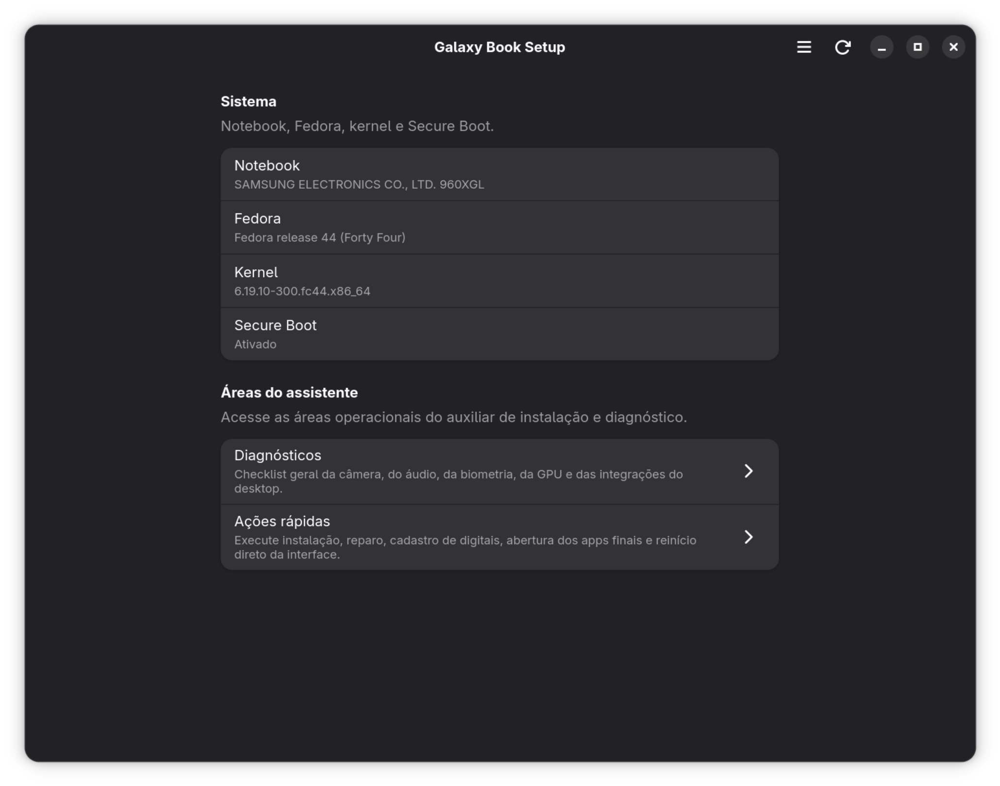
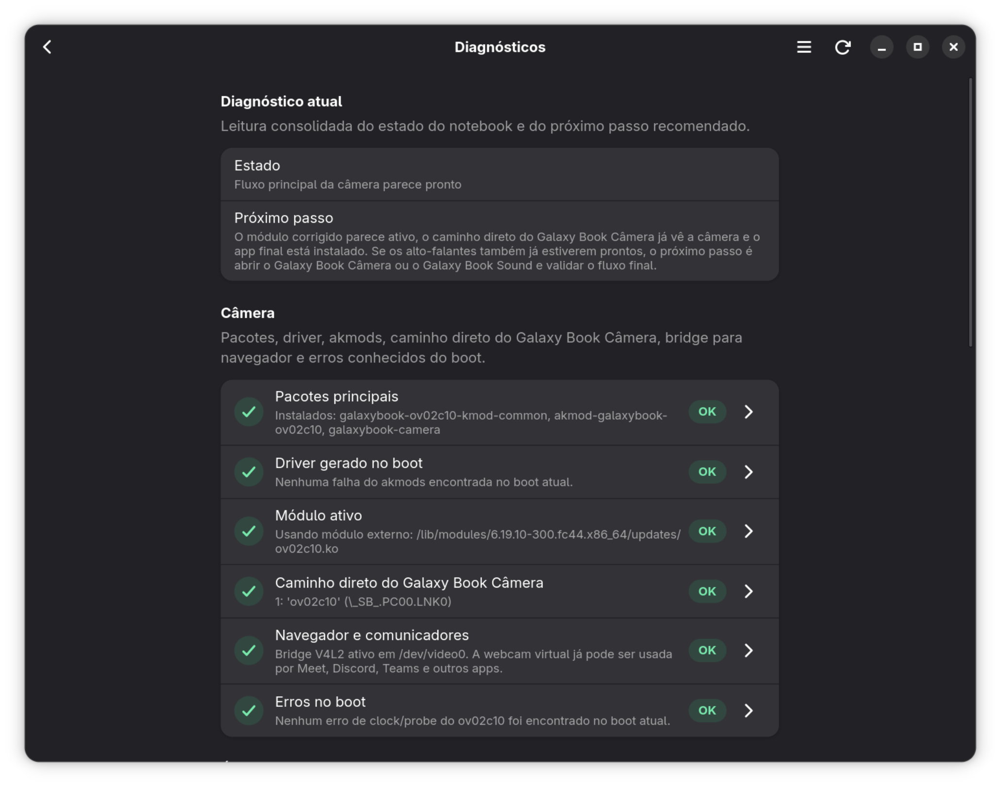
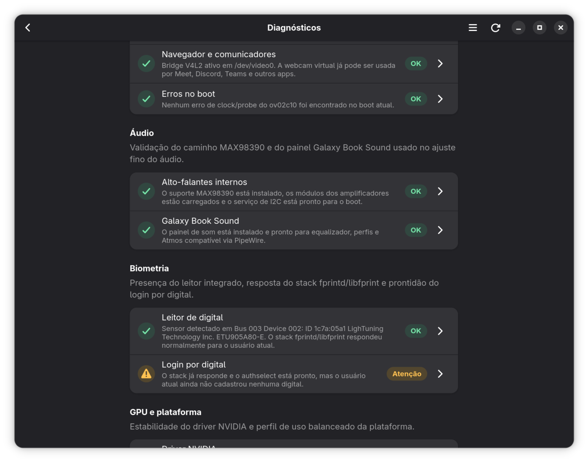
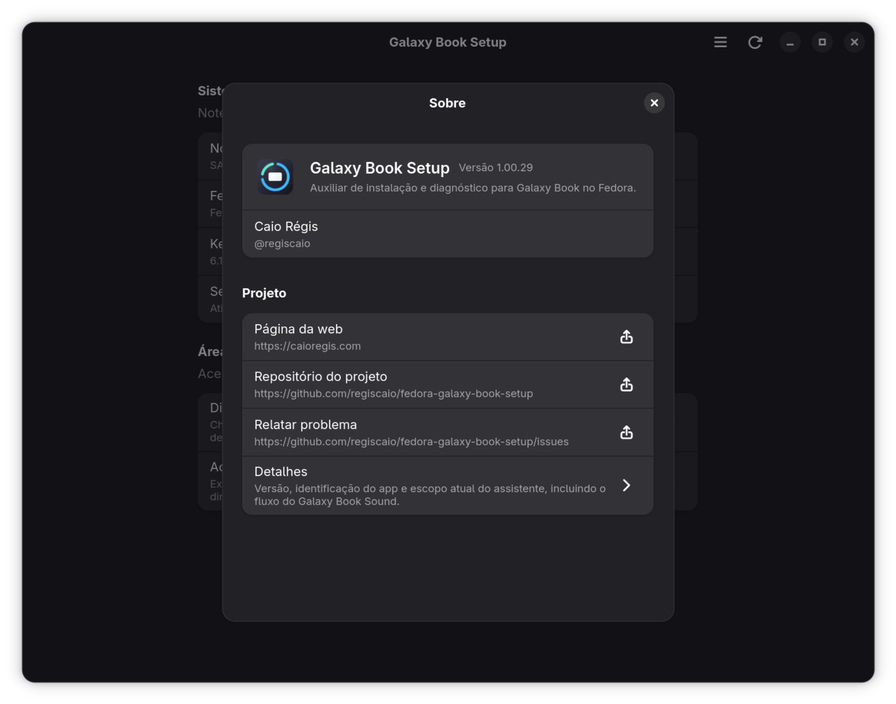

<p align="center">
  
</p>

<h1 align="center">Galaxy Book Setup</h1>

<p align="center">
  <a href="README.md">🇧🇷 Português</a> 
  <a href="README.en.md">🇺🇸 English</a> 
  <a href="README.es.md">🇪🇸 Español</a> 
  <a href="README.it.md">🇮🇹 Italiano</a>
</p>

## Instalación rápida

Para instalar el setup desde el repositorio DNF público:

```bash
sudo dnf config-manager addrepo --from-repofile=https://packages.caioregis.com/fedora/caioregis.repo
sudo dnf install galaxybook-setup
```

Con el repositorio configurado, el propio setup ya puede instalar el conjunto
principal del portátil mediante la acción rápida `Instalar soporte principal`,
trayendo la app de cámara, el driver `OV02C10` y el soporte `MAX98390` de los
altavoces. También puede ofrecer la instalación de `Galaxy Book Sound`, que se
encarga del ecualizador, los perfiles y Atmos compatible.

`Galaxy Book Setup` es un asistente de instalación y diagnóstico para
portátiles Samsung Galaxy Book en Fedora. La propuesta de la app es organizar
flujos de configuración que normalmente terminan repartidos entre terminal,
logs, paquetes RPM y validaciones manuales.

El foco inicial es la **cámara interna** del Galaxy Book4 Ultra, pero el
proyecto ya acompaña también el flujo de los **altavoces internos con
MAX98390**, además de GPU, fingerprint, perfil de plataforma e integraciones
generales del sistema.

## Interfaz actual

### Pantalla inicial



### Diagnósticos



### Audio interno



### Modal `Sobre`



## Alcance

Esta app no sustituye:

- el driver del kernel;
- la app final de cámara;
- herramientas de bajo nivel como `akmods`, `modinfo` o `journalctl`.

Su papel es funcionar como un **asistente de instalación y validación**,
mostrando el estado actual de la máquina y organizando los próximos pasos.

En el flujo de audio, eso significa separar bien las responsabilidades:
`Galaxy Book Setup` valida la ruta de los altavoces internos, organiza la
instalación y abre `Galaxy Book Sound`, mientras que la ecualización, los
perfiles y `Atmos compatible` quedan en la app de sonido.

## Relación con los otros repositorios

Este proyecto trabaja junto con:

- <https://github.com/regiscaio/fedora-galaxy-book-ov02c10>
- <https://github.com/regiscaio/fedora-galaxy-book-max98390>
- <https://github.com/regiscaio/fedora-galaxy-book-camera>
- <https://github.com/regiscaio/fedora-galaxy-book-sound>

Responsabilidades:

- `fedora-galaxy-book-ov02c10`: módulo `ov02c10` empaquetado para Fedora;
- `fedora-galaxy-book-max98390`: soporte empaquetado para los altavoces
  internos vía MAX98390;
- `fedora-galaxy-book-camera`: app de uso diario de la cámara;
- `fedora-galaxy-book-sound`: app de ecualizador, perfiles y Atmos compatible
  con backend propio en PipeWire;
- `fedora-galaxy-book-setup`: asistente de instalación, diagnóstico y flujo.

## Capacidades actuales

La versión actual de la app ya organiza la interfaz en áreas bien definidas:

- `Sistema`: resumen del portátil, Fedora, kernel y Secure Boot;
- `Diagnósticos`: checklist general con el estado de la cámara, del bridge para
  navegador, del audio, de `Galaxy Book Sound`, del lector de huellas, de la
  GPU, de la clave MOK de `akmods` y de las integraciones del escritorio,
  incluida la dock de GNOME usada en este portátil;
- `Acciones rápidas`: instalación, reparación y ajuste de prioridad del
  driver; activación de la webcam para navegador; activación de los altavoces
  internos; preparación de la clave de `Secure Boot` para `MOK`; instalación
  y apertura de `Galaxy Book Sound`; reparación del stack de fingerprint;
  activación del inicio de sesión por huella; apertura del registro de
  huellas; flujo NVIDIA; perfil equilibrado; reaplicación del perfil de la
  dock; reinicio y apertura de la app de cámara.

Dentro de `Diagnósticos`, cada línea lleva a una subsección de **acciones
sugeridas**. Eso permite abrir correcciones y validaciones más relevantes para
el ítem seleccionado sin perder la página general de `Acciones rápidas`.

La app también expone un resumen de alertas y errores a través de
notificaciones del escritorio. En docks y extensiones que soportan contador en
el launcher, el icono puede mostrar la cantidad total de ítems marcados como
`Atención` o `Error` en los diagnósticos.

La checklist cubre hoy:

- paquetes principales de la cámara;
- generación vía `akmods` y payload RPM externo para el kernel en ejecución y
  todos los kernels `kernel-core` instalados;
- origen del módulo `ov02c10` activo;
- detección de la cámara en la ruta directa de `libcamera` usada por `Galaxy
  Book Câmera`;
- bridge V4L2 para navegadores y comunicadores;
- errores conocidos del arranque;
- ruta MAX98390/MX98390 de los altavoces internos, que exige los dos módulos
  externos para cada kernel, un servicio persistente con resultado `success` y
  los cuatro vínculos I2C finales;
- presencia de `Galaxy Book Sound`;
- presencia del lector de huellas integrado;
- preparación del inicio de sesión por huella con `fprintd` y `authselect`;
- estado del driver NVIDIA y la observación de que `nvidia-smi` es opcional;
- preparación de la clave pública de `akmods` en `MOK` cuando `Secure Boot`
  está activo, sin confundir una clave que el usuario sin privilegios no puede
  leer con una clave ausente;
- perfil de uso de la plataforma, con destaque para `balanced`;
- estado de `Dash to Dock`, con comprobación del perfil de dock usado en este
  portátil;
- extensiones de GNOME como historial del portapapeles, GSConnect e iconos en
  el escritorio.

Las acciones rápidas no solo copian comandos: ejecutan los flujos principales
desde la propia interfaz, usando privilegios administrativos cuando es
necesario.

Hoy, las acciones disponibles incluyen:

- instalar el soporte principal del portátil directamente desde el setup,
  trayendo la app de cámara, el driver `OV02C10` y el soporte `MAX98390`;
- instalar el conjunto principal de la cámara;
- reconstruir y validar el driver `OV02C10` con `akmods` para todos los kernels
  instalados;
- reconciliar `ov02c10` para cada kernel, exigiendo un payload externo con el
  propietario RPM esperado y `vermagic` correspondiente, sin descargar ni
  sustituir en vivo un módulo que esté en uso;
- ajustar la prioridad del driver corregido solo después de validar todos los
  reemplazos. Los helpers del paquete eliminan únicamente shadows y overrides
  antiguos reconocidos, ejecutan `depmod`, reconstruyen cada initramfs y
  comprueban con `lsinitrd` que la imagen contiene el módulo de
  `extra/galaxybook-ov02c10`;
- activar la cámara para navegador vía `icamerasrc`, `v4l2-relayd` y
  `v4l2loopback`, preservando symlinks y configuraciones administrativas o del
  proveedor, manteniendo el acceso directo de `libcamera` y exigiendo una
  webcam virtual con capacidad de captura antes de finalizar. Si el OV02C10 está
  presente pero no tiene un controlador asociado, el configurador indica que se consulte
  el diagnóstico del sensor antes de activar el relay. Volver a aplicar la configuración
  deja en marcha un relay que ya ofrece captura. Si existe la
  regla administrativa heredada `/etc/udev/rules.d/90-hide-ipu6-v4l2.rules`,
  el setup la preserva y se detiene antes de recargar UDev o los servicios;
  revísela y, si corresponde, elimínela manualmente como administrador antes
  de volver a ejecutar la acción;
- activar el soporte de los altavoces internos vía `MAX98390`, generando los
  dos módulos empaquetados para cada kernel, validando su propietario RPM y
  habilitando el servicio I2C que solo finaliza cuando los cuatro
  amplificadores están vinculados;
- preparar la clave de `Secure Boot` para `akmods`, generando la clave local,
  creando la solicitud de importación en `MOK` y dejando el reinicio listo
  para `Enroll MOK` en el arranque;
- instalar `Galaxy Book Sound` para aplicar ecualización y Atmos compatible en
  la sesión vía PipeWire;
- reinstalar el stack de fingerprint con `fprintd` y `libfprint`;
- habilitar `with-fingerprint` en `authselect`;
- abrir directamente el registro de huellas en la configuración de usuarios;
- instalar o reparar el soporte NVIDIA;
- aplicar el perfil `balanced` de la plataforma;
- reaplicar el perfil de la dock de GNOME usado en este portátil, reactivando
  `Dash to Dock` y restaurando el comportamiento esperado de la dock inferior
  auto-ocultable;
- reiniciar normalmente, respetando los inhibidores del sistema y sin
  interrumpir compilaciones de módulos en curso;
- abrir `Galaxy Book Câmera`;
- abrir `Galaxy Book Sound`.

## Cámara después de actualizar el kernel

Después de una actualización de kernel, el arranque puede intentar cargar
`ov02c10` antes de que `akmods` termine de generar el módulo corregido para ese
kernel. En ese estado, el log registra:

```text
external clock 26000000 is not supported
probe with driver ov02c10 failed with error -22
```

Los flujos antiguos de reparación del driver podían dejar un
`/lib/modules/<kernel>/updates/ov02c10.ko` manual y sin dueño RPM. Eso
recuperaba la prioridad del módulo, pero podía generar avisos de `depmod` en
actualizaciones posteriores. El flujo actual enumera el kernel en ejecución y
todos los paquetes `kernel-core` instalados. Para cada versión, instala los
archivos de desarrollo necesarios, fuerza `akmods` y exige que el paquete
`kmod-galaxybook-ov02c10-<kernel>` proporcione un payload en
`extra/galaxybook-ov02c10`, con el propietario RPM esperado y un `vermagic`
correspondiente.

Solo después de que todos los reemplazos sean válidos, los helpers mantenidos
por el propio paquete del driver migran configuraciones antiguas de contenido
reconocido, eliminan overrides huérfanos reconocidos, ejecutan `depmod` y
reconstruyen el initramfs de cada kernel. El finalizador solo devuelve éxito
después de que `modinfo` resuelva el módulo externo y `lsinitrd` confirme la
copia correcta en la imagen; la ausencia, una copia in-tree o un fallo de
`dracut` interrumpen la acción. Este éxito privilegiado es la fuente de la
garantía del initramfs y publica una atestación `root:root` por kernel con
huellas fuertes del initramfs y del payload. El diagnóstico gráfico compara la
atestación con los metadatos actuales — y la invalida si cambia cualquiera de
los archivos — sin intentar leer el initramfs `0600`; la atestación no sustituye
la inspección de contenido realizada por el finalizador.

El diagnóstico ejecuta `cam` en el entorno normal del sistema. El tuning del
sensor es responsabilidad del paquete de la cámara en la ruta global de
búsqueda de libcamera,
`/usr/share/libcamera/ipa/simple/ov02c10.yaml`, no de una variable de entorno
privada del setup.

Existe una limitación física importante: `cam -l` y un grafo registrado prueban
la enumeración, no la estabilidad de la captura. Una ejecución anterior de
`cam -C30` terminó sin frames y registró `Frame sync`; el smoke test físico final
de la app en el arranque actual capturó `1920x1092` y validó foto y vídeo. Esto
demuestra que el pipeline puede funcionar, pero no valida la secuencia PLL para
26 MHz ni la estabilidad entre cold boot, suspensión y un nuevo probe. La
reconciliación, un initramfs correcto y un sensor listado indican preparación
del registro/arranque, no una garantía de captura estable.

Aunque `modinfo -n ov02c10` pase a apuntar al módulo corregido cuando `akmods`
termina, el grafo IPU6 de ese arranque ya puede haberse creado sin el sensor,
haciendo que `cam -l` no liste la cámara interna.

El diagnóstico ahora trata este caso como fallo de la ruta directa de la cámara
y sugiere `Ajustar prioridad del driver` seguido de reinicio. La acción prepara
todos los kernels, pero no intenta descargar un módulo en uso ni afirma que se
haya sustituido en vivo. El reinicio vuelve a crear el grafo de medios con el
driver correcto disponible desde el inicio del boot.

Durante toda la reconciliación, incluida la transacción DNF iniciada por Setup,
el flujo mantiene un mutex global exclusivo en
`/run/lock/galaxybook-kmod-lifecycle.lock`. Setup, los workers OV02C10 y
MAX98390 y el mantenimiento NVIDIA heredan y revalidan el mismo descriptor;
así, `akmods`, limpieza, `depmod`, `dracut` y publicación de estado no se
superponen entre drivers. El orden único es mutex global, mutex privado del
driver y lock de lectura RPM cuando corresponde. El coordinador abre primero un
inhibidor bloqueante de systemd para apagado, suspensión e inactividad y solo
después adquiere el mutex. Así, ningún descriptor de lock necesita atravesar
`systemd-inhibit`, que cierra los descriptores adicionales antes de iniciar su
hijo. El mismo shell mantiene el mutex desde DNF hasta la reconciliación final.
El inventario inicial y las validaciones antes y después de los finalizadores
usan snapshots estables bajo el lock RPM compartido. El coordinador libera ese
lock antes de invocar cada familia para que el finalizador preserve el orden
`global → privado → RPM`, y luego vuelve a adquirirlo para repetir propietario,
ruta, `vermagic`, firma y resolución de los módulos hasta la confirmación
final. El botón de reinicio solo se habilita cuando no hay ninguna compilación activa;
ejecuta el reinicio normal de systemd y respeta los demás inhibidores.

La acción NVIDIA usa el mismo protocolo: identifica y valida estrictamente el
kernel en ejecución y ejecuta `depmod -a <kernel>` y
`dracut --force --kver <kernel>` bajo el mutex global y el lock RPM compartido,
sin depender del kernel implícito de esos comandos.

La preparación de la clave MOK también mantiene este mutex desde la inspección
del par de claves hasta la publicación final del certificado y del marcador.
Así, `akmods` no puede firmar un módulo mientras se genera o publica su identidad
criptográfica.

## Altavoces después de actualizar el kernel

`MAX98390` ya no usa una copia manual en `/updates`. El setup fuerza el akmod
para cada kernel instalado y exige que `snd-hda-scodec-max98390` y
`snd-hda-scodec-max98390-i2c` se resuelvan en
`extra/galaxybook-max98390` y pertenezcan al paquete kmod específico de ese
kernel. Solo después de validar ambos reemplazos en todos los kernels, el setup
invoca el finalizador síncrono del propio paquete MAX98390 para cada kernel. El
finalizador conserva las copias antiguas en `/updates` y ejecuta `depmod` bajo
el mismo bloqueo que el worker RPM. La reconciliación solo termina cuando
`modinfo` selecciona en `/extra` los dos módulos íntegros del RPM de ese kernel.

En el kernel en ejecución, el servicio empaquetado es la única autoridad de
arranque para cargar los módulos y crear los clientes I2C. El diagnóstico
acepta tanto IDs ACPI `MAX98390` como `MX98390`, exige
`ActiveState=active`, `Result=success` y los cuatro vínculos finales con el
driver. Un `EPROBE_DEFER` transitorio no se trata como fallo cuando los cuatro
vínculos aparecen al final.

## Secure Boot y MOK

Si alguna acción rápida falla con algo como:

```text
modprobe: ERROR: could not insert 'ov02c10': Key was rejected by service
modprobe: ERROR: could not insert 'snd_hda_scodec_max98390': Key was rejected by service
```

el problema no es la compilación del módulo en sí. Ese error significa que el
kernel sigue con `Secure Boot` activo, pero la clave usada para firmar el
módulo todavía no fue aceptada en `MOK`.

La ruta esperada es:

```bash
mokutil --test-key /etc/pki/akmods/certs/public_key.der
sudo mokutil --import /etc/pki/akmods/certs/public_key.der
```

El setup considera la clave inscrita cuando `mokutil --test-key` termina con
estado cero o cuando la huella SHA-1 exacta del certificado actual aparece en
`mokutil --list-enrolled`. El texto por sí solo no se acepta como prueba porque
puede proceder de un error, locale o versión diferente.

El propio `Galaxy Book Setup` ahora expone la acción rápida
`Preparar clave de Secure Boot`, que:

- genera la clave local de `akmods` con `kmodgenca` cuando hace falta;
- pide una contraseña temporal de `MOK` en la interfaz;
- crea la solicitud de importación en `mokutil`;
- actualiza el diagnóstico para mostrar si la clave quedó lista, pendiente de
  reinicio o si todavía necesita atención.

El proceso gráfico no necesita leer la clave privada, que normalmente está
protegida para `root:akmods`. Cuando esa lectura está prohibida, el diagnóstico
devuelve un estado desconocido en vez de afirmar incorrectamente que la clave
está ausente. Usa el certificado público, un módulo externo firmado que ya haya
sido aceptado o la solicitud exacta listada por `mokutil --list-new` para
reconocer los estados que se pueden demostrar.
El helper privilegiado mantiene los directorios del certificado y la clave
privada como `root:akmods` con modo `0750`. Acepta los enlaces simbólicos
internos creados por `kmodgenca` solo cuando el enlace, la jerarquía y el destino
superan las verificaciones de confinamiento, propietario y permisos; rechaza
enlaces rotos o que escapen de esos directorios. El estado público escribe cada
artefacto de forma atómica como un archivo regular `root:root` `0644` con un
solo enlace: una copia del certificado DER público y su identidad versionada,
con CN para presentación, huella SHA-1 para correlacionar exactamente MOK y
número de serie X.509 para correlacionar exactamente `modinfo -F sig_key`. La
GUI cruza ambos archivos y el módulo firmado; una publicación interrumpida o
divergente falla de forma cerrada y converge en la siguiente ejecución del
helper. Ninguna clave privada se copia al estado de la app.

Para no confundir un payload recién instalado en disco con un módulo antiguo ya
cargado, el diagnóstico compara primero la sección GNU build-id, byte a byte.
`srcversion` solo se usa como fallback estricto cuando ni el kernel ni el módulo
exponen build-id.

Después de eso:

1. reinicia el portátil;
2. entra en `Enroll MOK` en la pantalla azul del arranque;
3. confirma la contraseña definida en `mokutil --import`;
4. vuelve a Fedora, actualiza el diagnóstico y ejecuta la acción rápida otra
   vez si la validación en vivo sigue pendiente.

Los payloads firmados se pueden generar y validar en disco antes de inscribir
la clave. Si la solicitud exacta está pendiente, el setup habilita las units,
aplaza únicamente la validación en vivo de MAX98390 —que el kernel todavía
rechazaría— y permite el reinicio necesario para completar `Enroll MOK`. Sin
una solicitud pendiente demostrada, la acción falla de forma explícita y no
sugiere el reinicio como reparación del driver; el botón de reinicio genérico
sigue disponible cuando no hay ningún build de akmods activo.

## Instalación para usuarios

### Vía repositorio DNF público

La ruta recomendada para usuarios finales es:

```bash
sudo dnf config-manager addrepo --from-repofile=https://packages.caioregis.com/fedora/caioregis.repo
sudo dnf install galaxybook-setup
```

Después de eso, dentro de la propia app:

1. abre `Acciones rápidas`;
2. ejecuta `Instalar soporte principal`;
3. usa las acciones específicas si cámara, audio, NVIDIA o la dock todavía
   necesitan ajuste.

### Vía RPM local

El proyecto también puede empaquetarse localmente:

```bash
make rpm
```

Después, el RPM puede instalarse con:

```bash
sudo dnf install /ruta/a/galaxybook-setup-*.rpm
```

## Build

Dependencias de build en Fedora:

```bash
sudo dnf install make podman cargo rust pkgconf-pkg-config gtk4-devel libadwaita-devel
```

Si el host no tiene el toolchain gráfico completo, el `Makefile` usa un
contenedor rootless con `podman`; `make` y `podman` también son necesarios para
generar los artefactos RPM reproducibles.

En un repositorio con el historial completo, Cargo y RPM usan `scripts/package-version.sh`.
El script registra los commits que solo revisan el RPM: `1.00.48-2` mantiene la aplicación
en `1.00.48`. El siguiente commit normal genera `1.00.49-1` sin ajustes de entorno.

Comandos principales:

```bash
make build
make test
make dist
make srpm
make rpm
```

Para instalar el launcher local de desarrollo:

```bash
make install-local
```

## Empaquetado

Archivos relevantes:

- spec RPM: [`packaging/fedora/galaxybook-setup.spec`](packaging/fedora/galaxybook-setup.spec)
- launcher: [`data/com.caioregis.GalaxyBookSetup.desktop`](data/com.caioregis.GalaxyBookSetup.desktop)
- metadatos AppStream: [`data/com.caioregis.GalaxyBookSetup.metainfo.xml`](data/com.caioregis.GalaxyBookSetup.metainfo.xml)

El RPM usa dependencias débiles (`Recommends` y `Suggests`) para señalar los
paquetes más importantes del flujo:

- `galaxybook-ov02c10-kmod-common`
- `akmod-galaxybook-ov02c10`
- `kmod-galaxybook-ov02c10`
- `akmod-galaxybook-max98390`
- `galaxybook-max98390-kmod-common`
- `kmod-galaxybook-max98390`
- `galaxybook-camera >= 1.00.43`
- `galaxybook-sound >= 1.00.18` (opcional)

El ciclo actual requiere como mínimo `galaxybook-ov02c10 >= 1.00.25` para la
familia OV02C10, `galaxybook-max98390 >= 1.00.12` para la familia MAX98390 y
`galaxybook-camera >= 1.00.43`. La acción opcional de sonido instala
`galaxybook-sound >= 1.00.18`. Actualice Setup y las familias completas de
drivers en la misma transacción para no mezclar contratos de lifecycle antiguos
y nuevos.

Al migrar desde `galaxybook-setup <= 1.00.47`, no inicie la primera actualización
desde la interfaz antigua: un shell privilegiado que ya esté en ejecución no
puede incorporarse retroactivamente al nuevo mutex. Cierre todas las ventanas
de Setup, espere a que termine cualquier acción activa y actualice primero solo
el coordinador, con las dependencias débiles deshabilitadas:

```bash
sudo dnf --setopt=install_weak_deps=False --refresh upgrade galaxybook-setup
```

Los requisitos condicionales también actualizan cualquier paquete
`*-kmod-common` instalado al contrato compatible, pero no instalan una familia
de drivers ausente. Después, vuelva a abrir Setup `1.00.48` o posterior y use su
acción **Actualizar paquetes**; esta segunda etapa mantiene el inhibitor y el
mutex global desde el DNF de los miembros restantes hasta la reconciliación
final.

Eso permite que la app se instale incluso antes del setup completo de la
cámara, lo que es deseable para un asistente de instalación.

## Roadmap

Próximas evoluciones previstas:

- comprobaciones generales de compatibilidad del Galaxy Book con Fedora;
- más flujos asistidos para integraciones del entorno GNOME y periféricos del
  portátil;
- profundizar las lecturas de fingerprint con foco en validación post-suspensión
  y escenarios de sensor ocupado.

## Licencia

Este proyecto se distribuye bajo la licencia **GPL-3.0-only**. Consulta el
archivo [LICENSE](LICENSE).
