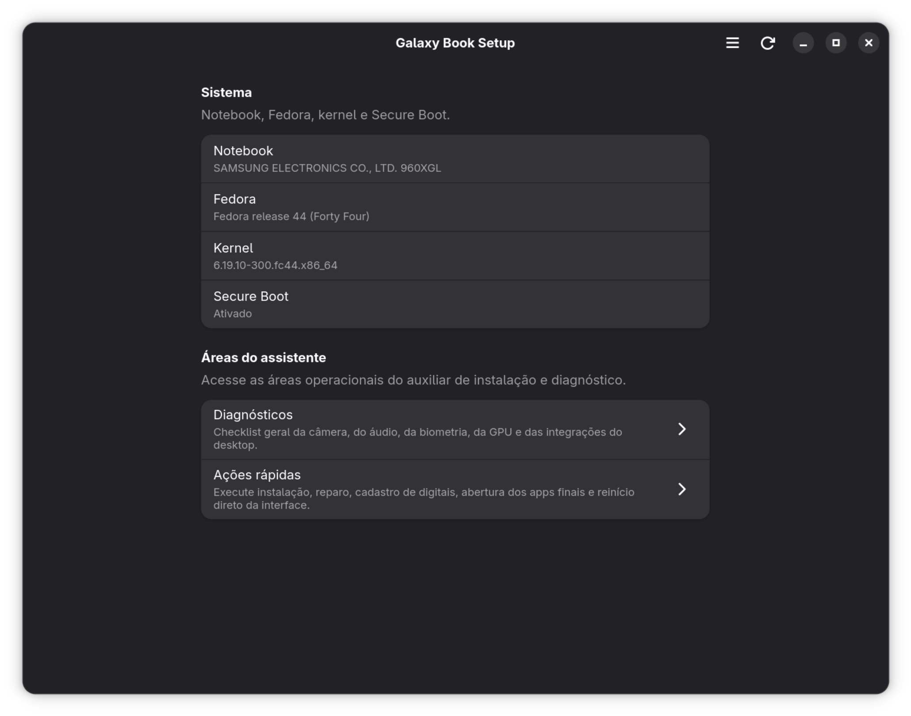
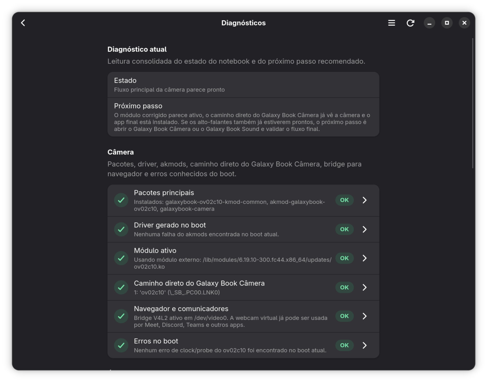
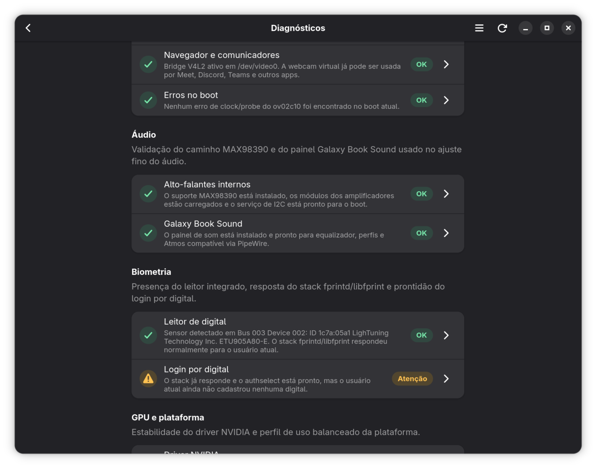
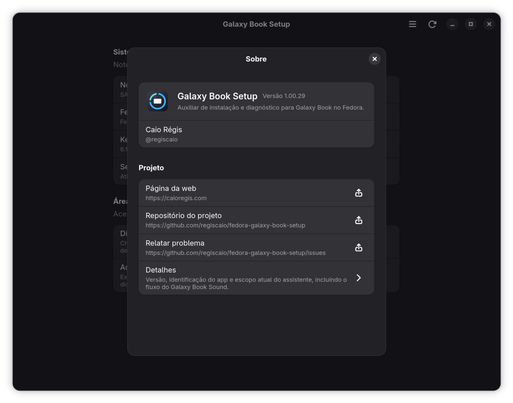

<p align="center">
  
</p>

<h1 align="center">Galaxy Book Setup</h1>

<p align="center">
  <a href="README.md">🇧🇷 Português</a> 
  <a href="README.en.md">🇺🇸 English</a> 
  <a href="README.es.md">🇪🇸 Español</a> 
  <a href="README.it.md">🇮🇹 Italiano</a>
</p>

## Installazione rapida

Per installare il setup dal repository DNF pubblico:

```bash
sudo dnf config-manager addrepo --from-repofile=https://packages.caioregis.com/fedora/caioregis.repo
sudo dnf install galaxybook-setup
```

Con il repository configurato, il setup stesso riesce già a installare il
set principale del notebook tramite l'azione rapida `Installa supporto
principale`, portando con sé l'app fotocamera, il driver `OV02C10` e il
supporto `MAX98390` per gli altoparlanti. Può anche offrire l'installazione di
`Galaxy Book Sound`, che resta responsabile di equalizzatore, profili e Atmos
compatibile.

`Galaxy Book Setup` è un assistente di installazione e diagnostica per
notebook Samsung Galaxy Book su Fedora. La proposta dell'app è organizzare
flussi di configurazione che normalmente finiscono dispersi tra terminale,
log, pacchetti RPM e validazioni manuali.

Il focus iniziale è la **fotocamera interna** del Galaxy Book4 Ultra, ma il
progetto accompagna già anche il flusso degli **altoparlanti interni con
MAX98390**, oltre a GPU, fingerprint, profilo di piattaforma e integrazioni
generali del sistema.

## Interfaccia attuale

### Schermata iniziale



### Diagnostica



### Audio interno



### Finestra modale `Informazioni`



## Ambito

Questa app non sostituisce:

- il driver del kernel;
- l'app finale della fotocamera;
- strumenti di basso livello come `akmods`, `modinfo` o `journalctl`.

Il suo ruolo è funzionare come un **assistente di installazione e validazione**,
mostrando lo stato attuale della macchina e organizzando i prossimi passi.

Nel flusso audio, questo significa separare bene le responsabilità: `Galaxy
Book Setup` valida il percorso degli altoparlanti interni, organizza
l'installazione e apre `Galaxy Book Sound`, mentre equalizzazione, profili e
`Atmos compatibile` restano nell'app audio.

## Relazione con gli altri repository

Questo progetto lavora insieme a:

- <https://github.com/regiscaio/fedora-galaxy-book-ov02c10>
- <https://github.com/regiscaio/fedora-galaxy-book-max98390>
- <https://github.com/regiscaio/fedora-galaxy-book-camera>
- <https://github.com/regiscaio/fedora-galaxy-book-sound>

Responsabilità:

- `fedora-galaxy-book-ov02c10`: modulo `ov02c10` pacchettizzato per Fedora;
- `fedora-galaxy-book-max98390`: supporto pacchettizzato agli altoparlanti
  interni via MAX98390;
- `fedora-galaxy-book-camera`: app di uso quotidiano della fotocamera;
- `fedora-galaxy-book-sound`: app di equalizzatore, profili e Atmos
  compatibile con backend PipeWire proprio;
- `fedora-galaxy-book-setup`: assistente di installazione, diagnostica e flusso.

## Capacità attuali

La versione attuale dell'app organizza già l'interfaccia in aree ben definite:

- `Sistema`: riepilogo di notebook, Fedora, kernel e Secure Boot;
- `Diagnostica`: checklist generale con lo stato di fotocamera, bridge per
  browser, audio, `Galaxy Book Sound`, lettore di impronte, GPU, chiave MOK
  di `akmods` e integrazioni desktop, inclusa la dock GNOME usata su questo
  notebook;
- `Azioni rapide`: installazione, riparazione e regolazione di priorità del
  driver; attivazione della webcam per browser; attivazione degli altoparlanti
  interni; preparazione della chiave di `Secure Boot` per `MOK`; installazione
  e apertura di `Galaxy Book Sound`; riparazione dello stack fingerprint;
  attivazione del login con impronta; apertura della registrazione delle
  impronte; flusso NVIDIA; profilo bilanciato; riapplicazione del profilo
  della dock; riavvio e apertura dell'app fotocamera.

Dentro `Diagnostica`, ogni riga porta a una sottosezione di **azioni
suggerite**. Questo permette di aprire correzioni e validazioni più rilevanti
per l'elemento selezionato senza perdere la pagina generale di `Azioni rapide`.

L'app espone anche un riepilogo di avvisi ed errori tramite notifiche desktop.
In dock ed estensioni che supportano il contatore sul launcher, l'icona può
mostrare il numero totale di elementi marcati come `Attenzione` o `Errore`
nei diagnostici.

La checklist copre oggi:

- pacchetti principali della fotocamera;
- generazione tramite `akmods` e payload RPM esterno per il kernel in
  esecuzione e per tutti i kernel `kernel-core` installati;
- origine del modulo `ov02c10` attivo;
- rilevamento della fotocamera nel percorso diretto di `libcamera` usato da
  `Galaxy Book Câmera`;
- bridge V4L2 per browser e applicazioni di comunicazione;
- errori noti di boot;
- percorso MAX98390/MX98390 degli altoparlanti interni, che richiede entrambi i
  moduli esterni per ciascun kernel, un servizio persistente con risultato
  `success` e tutti e quattro i collegamenti I2C finali;
- presenza di `Galaxy Book Sound`;
- presenza del lettore di impronte integrato;
- preparazione del login con impronta tramite `fprintd` e `authselect`;
- stato del driver NVIDIA e l'osservazione che `nvidia-smi` è opzionale;
- stato di preparazione della chiave pubblica di `akmods` in `MOK` quando
  `Secure Boot` è attivo, senza confondere una chiave illeggibile dall'utente
  non privilegiato con una chiave assente;
- profilo d'uso della piattaforma, con `balanced` in evidenza come
  raccomandazione;
- stato di `Dash to Dock`, con verifica del profilo della dock usato su questo
  notebook;
- estensioni GNOME come cronologia degli appunti, GSConnect e icone sul
  desktop.

Le azioni rapide non si limitano a copiare comandi: eseguono i flussi
principali direttamente dall'interfaccia, usando privilegi amministrativi
quando necessario.

Oggi, le azioni disponibili includono:

- installare il supporto principale del notebook direttamente dal setup,
  portando con sé l'app fotocamera, il driver `OV02C10` e il supporto
  `MAX98390`;
- installare il set principale della fotocamera;
- ricostruire e convalidare il driver `OV02C10` con `akmods` per tutti i kernel
  installati;
- riconciliare `ov02c10` per ogni kernel, richiedendo un payload esterno con il
  proprietario RPM atteso e un `vermagic` corrispondente, senza scaricare o
  sostituire dal vivo un modulo in uso;
- regolare la priorità del driver corretto solo dopo aver convalidato tutte le
  sostituzioni. Gli helper del pacchetto rimuovono soltanto shadow e override
  legacy riconosciuti, eseguono `depmod`, ricostruiscono ciascun initramfs e
  verificano con `lsinitrd` che l'immagine contenga il modulo di
  `extra/galaxybook-ov02c10`;
- attivare la fotocamera per browser tramite `icamerasrc`, `v4l2-relayd` e
  `v4l2loopback`, preservando symlink e configurazioni amministrative o del
  vendor, mantenendo l'accesso diretto di `libcamera` e richiedendo una webcam
  virtuale con capacità di acquisizione prima di terminare. Se il sensore OV02C10
  è presente ma privo di driver, il programma indica di consultarne la diagnostica
  prima di avviare il relay. Riapplicare la configurazione mantiene attivo un relay
  che offre già la funzione di acquisizione. Se esiste la regola
  amministrativa legacy `/etc/udev/rules.d/90-hide-ipu6-v4l2.rules`, il setup
  la preserva e si interrompe prima di ricaricare UDev o i servizi; esaminala
  e, se opportuno, rimuovila manualmente come amministratore prima di eseguire
  nuovamente l'azione;
- attivare il supporto agli altoparlanti interni via `MAX98390`, generando
  entrambi i moduli pacchettizzati per ciascun kernel, convalidandone la
  proprietà RPM e abilitando il servizio I2C che termina con successo solo
  quando tutti e quattro gli amplificatori sono collegati;
- preparare la chiave di `Secure Boot` per `akmods`, generando la chiave
  locale, creando la richiesta di importazione in `MOK` e lasciando il
  riavvio pronto per `Enroll MOK` all'avvio;
- installare `Galaxy Book Sound` per applicare equalizzazione e Atmos
  compatibile nella sessione via PipeWire;
- reinstallare lo stack fingerprint con `fprintd` e `libfprint`;
- abilitare `with-fingerprint` in `authselect`;
- aprire direttamente la registrazione delle impronte nelle impostazioni
  utente;
- installare o riparare il supporto NVIDIA;
- applicare il profilo di piattaforma `balanced`;
- riapplicare il profilo della dock GNOME usato su questo notebook,
  riattivando `Dash to Dock` e ripristinando il comportamento atteso della
  dock inferiore auto-nascosta;
- riavviare normalmente, rispettando gli inhibitor di sistema e senza
  interrompere le compilazioni dei moduli in corso;
- aprire `Galaxy Book Câmera`;
- aprire `Galaxy Book Sound`.

## Fotocamera dopo aggiornamenti del kernel

Dopo un aggiornamento del kernel, il boot può provare a caricare `ov02c10` prima
che `akmods` finisca di generare il modulo corretto per quel kernel. In questo
stato, il log registra:

```text
external clock 26000000 is not supported
probe with driver ov02c10 failed with error -22
```

I vecchi flussi di riparazione del driver potevano lasciare un
`/lib/modules/<kernel>/updates/ov02c10.ko` manuale e non posseduto da RPM. Questo
recuperava la priorità del modulo, ma poteva generare avvisi `depmod` negli
aggiornamenti successivi. Il flusso attuale enumera il kernel in esecuzione e
tutti i pacchetti `kernel-core` installati. Per ogni versione installa i file
di sviluppo necessari, forza `akmods` e richiede che il pacchetto
`kmod-galaxybook-ov02c10-<kernel>` fornisca un payload in
`extra/galaxybook-ov02c10`, con il proprietario RPM atteso e un `vermagic`
corrispondente.

Solo dopo che tutte le sostituzioni sono valide, gli helper mantenuti dal
pacchetto del driver migrano le configurazioni legacy dal contenuto
riconosciuto, rimuovono gli override orfani riconosciuti, eseguono `depmod` e
ricostruiscono l'initramfs di ogni kernel. Il finalizzatore restituisce successo
solo dopo che `modinfo` risolve il modulo esterno e `lsinitrd` conferma la copia
corretta nell'immagine; un modulo assente, una copia in-tree o un errore di
`dracut` interrompono l'azione. Questo successo privilegiato è la fonte della
garanzia sull'initramfs e pubblica un'attestazione `root:root` per kernel con
fingerprint forti dell'initramfs e del payload. La diagnostica grafica confronta
l'attestazione con i metadati correnti — e la invalida se uno dei file cambia —
senza tentare di leggere l'initramfs `0600`; l'attestazione non sostituisce
l'ispezione del contenuto eseguita dal finalizzatore.

La diagnostica esegue `cam` nell'ambiente normale del sistema. Il tuning del
sensore è responsabilità del pacchetto della fotocamera nel percorso globale di
ricerca di libcamera, `/usr/share/libcamera/ipa/simple/ov02c10.yaml`, non di una
variabile d'ambiente privata del setup.

Esiste un importante limite fisico: `cam -l` e un grafo registrato provano
l'enumerazione, non la stabilità dell'acquisizione. Una precedente esecuzione di
`cam -C30` è terminata senza frame registrando `Frame sync`; lo smoke test fisico
finale dell'app nel boot corrente ha acquisito `1920x1092` e validato foto e
video. Questo dimostra che la pipeline può funzionare, ma non valida la sequenza
PLL per 26 MHz né la stabilità tra cold boot, sospensione e un nuovo probe.
Riconciliazione, initramfs corretto e sensore elencato indicano prontezza di
registrazione/boot, non una garanzia di acquisizione stabile.

Anche se `modinfo -n ov02c10` poi punta al modulo corretto dopo la fine di
`akmods`, il grafo IPU6 di quel boot può già essere stato creato senza il
sensore, quindi `cam -l` non elenca la fotocamera interna.

La diagnostica ora tratta questo caso come errore del percorso diretto della
fotocamera e suggerisce `Regolare la priorità del driver` seguito dal riavvio.
L'azione prepara tutti i kernel, ma non tenta di scaricare un modulo in uso né
afferma che sia stato sostituito dal vivo. Il riavvio ricrea il grafo
multimediale con il driver corretto disponibile fin dall'inizio del boot.

Durante l'intera riconciliazione, inclusa la transazione DNF avviata da Setup,
il flusso mantiene un mutex globale esclusivo in
`/run/lock/galaxybook-kmod-lifecycle.lock`. Setup, i worker OV02C10 e MAX98390 e
la manutenzione NVIDIA ereditano e riconvalidano lo stesso descrittore; così
`akmods`, pulizia, `depmod`, `dracut` e pubblicazione dello stato non si
sovrappongono tra driver. L'ordine unico è mutex globale, mutex privato del
driver e lock RPM in lettura quando applicabile. Il coordinatore apre prima un
inhibitor systemd bloccante per arresto, sospensione e inattività e solo dopo
acquisisce il mutex. In questo modo nessun descrittore di lock deve attraversare
`systemd-inhibit`, che chiude i descrittori aggiuntivi prima di avviare il figlio.
La stessa shell mantiene il mutex da DNF fino alla riconciliazione finale.
L'inventario iniziale e le convalide prima e dopo i finalizzatori usano snapshot
stabili sotto il lock RPM condiviso. Il coordinatore rilascia quel lock prima di
invocare ogni famiglia affinché il finalizzatore preservi l'ordine
`globale → privato → RPM`, quindi lo riacquisisce per ripetere proprietà,
percorso, `vermagic`, firma e risoluzione dei moduli fino alla conferma finale. Il
pulsante di riavvio viene abilitato solo quando non è attiva alcuna compilazione;
esegue il normale riavvio di systemd e rispetta tutti gli altri inhibitor.

L'azione NVIDIA usa lo stesso protocollo: identifica e convalida rigorosamente
il kernel in esecuzione, quindi esegue `depmod -a <kernel>` e
`dracut --force --kver <kernel>` sotto il mutex globale e il lock RPM condiviso,
senza dipendere dal kernel implicito dei comandi.

Anche la preparazione della chiave MOK mantiene questo mutex dall'ispezione
della coppia di chiavi fino alla pubblicazione finale del certificato e del
marker. In questo modo `akmods` non può firmare un modulo mentre la sua identità
crittografica viene generata o pubblicata.

## Altoparlanti dopo aggiornamenti del kernel

`MAX98390` non usa più una copia manuale in `/updates`. Il setup forza l'akmod
per ogni kernel installato e richiede che `snd-hda-scodec-max98390` e
`snd-hda-scodec-max98390-i2c` si risolvano in
`extra/galaxybook-max98390` e appartengano al pacchetto kmod specifico di quel
kernel. Solo dopo aver validato entrambe le sostituzioni su tutti i kernel, il
setup richiama il finalizzatore sincrono del pacchetto MAX98390 per ogni kernel.
Il finalizzatore conserva le vecchie copie in `/updates` ed esegue `depmod` con
lo stesso lock del worker RPM. La riconciliazione termina soltanto quando
`modinfo` seleziona in `/extra` entrambi i moduli integri dell'RPM per quel kernel.

Sul kernel in esecuzione, il servizio pacchettizzato è l'unica autorità di boot
per il caricamento dei moduli e la creazione dei client I2C. La diagnostica
accetta sia gli ID ACPI `MAX98390` sia `MX98390`, richiede
`ActiveState=active`, `Result=success` e tutti e quattro i collegamenti finali
al driver. Un `EPROBE_DEFER` transitorio non viene trattato come errore quando
alla fine sono presenti tutti e quattro i collegamenti.

## Secure Boot e MOK

La modalità amministrativa `reconcile-kmods prepare-all` prepara su disco entrambi i driver per tutti i kernel. Richiede Secure Boot attivo, una chiave registrata e nessuna operazione MOK in attesa. Non riavvia il sistema, non avvia il servizio audio e non verifica il funzionamento fisico.

Una compilazione riuscita non garantisce che DNF abbia installato il pacchetto RPM. Se `akmods` registra un nuovo errore per il driver e il kernel in questione, Setup si ferma prima di finalizzare i moduli, anche se il comando restituisce zero. Un vecchio registro di errore non impedisce da solo un nuovo tentativo.

Dalla versione 1.00.49 la riconciliazione pubblica una copia del certificato pubblico e il suo marcatore di identità per la diagnostica solo dopo aver verificato la registrazione. Non modifica il MOK né i permessi della chiave originale. Per aggiornare solo la diagnostica eseguire `sudo /usr/libexec/galaxybook-setup/prepare-secure-boot-key --publish-enrolled`. Se la registrazione non è confermata, il comando termina senza richiedere l'importazione. Pubblicare un'identità già registrata non richiede password MOK né riavvio.

Se un'azione rapida fallisce con qualcosa del tipo:

```text
modprobe: ERROR: could not insert 'ov02c10': Key was rejected by service
modprobe: ERROR: could not insert 'snd_hda_scodec_max98390': Key was rejected by service
```

il kernel ha rifiutato la firma del modulo. Ciò non dimostra che manchi la MOK
locale: verifica quale modulo è stato selezionato e se il certificato con cui
è stato firmato è quello previsto. Per verificare la registrazione senza modificarla:

```bash
sudo env LC_ALL=C mokutil --ignore-keyring --test-key /etc/pki/akmods/certs/public_key.der
sudo openssl x509 -inform DER -in /etc/pki/akmods/certs/public_key.der -noout -fingerprint -sha1
sudo env LC_ALL=C mokutil --list-enrolled
```

Dalla versione 1.00.49-2, Setup richiede due verifiche concordanti. Il test
deve restituire esattamente `<percorso del DER> is already enrolled`, senza
errori in uscita e con stato 0 o 1 (la convenzione dipende dalla versione).
L’elenco deve essere letto senza errori e contenere l’impronta SHA-1 completa
dello stesso certificato. `is not enrolled` non dimostra la registrazione,
nemmeno con stato 0. Se i risultati non concordano, lo stato è sconosciuto:
non importare di nuovo la chiave né impostare una password. Se la chiave è già
registrata, non occorre importarla.

Lo stesso `Galaxy Book Setup` ora espone l'azione rapida
`Preparare la chiave di Secure Boot`, che:

- genera la chiave locale di `akmods` con `kmodgenca` quando serve;
- permette di richiedere l’importazione se la chiave risulta assente; solo
  in questo caso occorre impostare una password temporanea per `MOK`;
- aggiorna la diagnostica per mostrare se la chiave è pronta, in attesa di
  riavvio o se richiede ancora attenzione.

Il processo grafico non deve leggere la chiave privata, che normalmente è
protetta per `root:akmods`. Quando la lettura è vietata, la diagnostica
restituisce uno stato sconosciuto invece di dichiarare erroneamente che la
chiave è assente. Un modulo esterno firmato già caricato indica che è stato
accettato in questo avvio; una richiesta esatta in `mokutil --list-new`
indica un’operazione in sospeso. Nessuno dei due segnali sostituisce la
conferma della registrazione del certificato pubblico.
L'helper privilegiato mantiene le directory del certificato e della chiave
privata come `root:akmods` con modalità `0750`. Accetta i link simbolici interni
creati da `kmodgenca` soltanto quando link, gerarchia e destinazione superano le
verifiche di confinamento, proprietà e permessi; i link interrotti o che escono
da queste directory vengono rifiutati. Lo stato pubblico scrive ogni artefatto
atomicamente come file regolare `root:root` `0644` con un solo link: una copia
del certificato DER pubblico e la sua identità versionata, con CN per la
visualizzazione, impronta SHA-1 per correlare esattamente MOK e numero di serie
X.509 per correlare esattamente `modinfo -F sig_key`. La GUI verifica in modo
incrociato entrambi i file e il modulo firmato; una pubblicazione interrotta o
divergente fallisce in modo chiuso e converge alla successiva esecuzione
dell'helper. Nessuna chiave privata viene copiata nello stato dell'app.

Per non confondere un payload appena installato sul disco con un modulo più
vecchio già caricato, la diagnostica confronta prima la sezione GNU build-id,
byte per byte. `srcversion` viene usato solo come fallback rigoroso quando né il
kernel né il modulo espongono un build-id.

Solo se l’assenza è stata confermata e hai richiesto una nuova importazione:

1. riavvia il notebook;
2. entra in `Enroll MOK` nella schermata blu di boot;
3. conferma la password definita durante `mokutil --import`;
4. torna in Fedora, aggiorna la diagnostica ed esegui di nuovo l'azione rapida
   se la convalida dal vivo è ancora in sospeso.

I payload firmati possono essere generati e convalidati su disco prima
dell'iscrizione della chiave. Se la richiesta esatta è in sospeso, il setup
abilita le unità, rinvia soltanto la convalida dal vivo di MAX98390 —che il
kernel rifiuterebbe ancora— e consente il riavvio necessario per completare
`Enroll MOK`. Senza una richiesta pendente dimostrata, l'azione fallisce in
modo esplicito e non suggerisce il riavvio come riparazione del driver; il
pulsante di riavvio generico resta disponibile se nessuna build akmods è attiva.

## Installazione per utenti

### Tramite repository DNF pubblico

Il percorso consigliato per gli utenti finali è:

```bash
sudo dnf config-manager addrepo --from-repofile=https://packages.caioregis.com/fedora/caioregis.repo
sudo dnf install galaxybook-setup
```

Dopo questo, dall'interno della stessa app:

1. apri `Azioni rapide`;
2. esegui `Installa supporto principale`;
3. usa le azioni specifiche se fotocamera, audio, NVIDIA o la dock hanno
   ancora bisogno di regolazioni.

### Tramite RPM locali

Il progetto può anche essere pacchettizzato localmente:

```bash
make rpm
```

Poi l'RPM può essere installato con:

```bash
sudo dnf install /percorso/verso/galaxybook-setup-*.rpm
```

## Build

Dipendenze di build su Fedora:

```bash
sudo dnf install make podman cargo rust pkgconf-pkg-config gtk4-devel libadwaita-devel
```

Se l'host non ha il toolchain grafico completo, il `Makefile` usa un container
rootless con `podman`; `make` e `podman` sono necessari anche per generare gli
artefatti RPM riproducibili.

In un repository con la cronologia completa, Cargo e RPM usano `scripts/package-version.sh`.
Se una correzione mantiene la versione dell'applicazione, aumenta solo la revisione RPM.
In questo modo `1.00.49-2` aggiorna `1.00.49-1`; il commit ordinario successivo
genera `1.00.50-1` senza modificare le variabili d'ambiente.

Comandi principali:

```bash
make build
make test
make dist
make srpm
make rpm
```

Per installare il launcher locale di sviluppo:

```bash
make install-local
```

## Packaging

File rilevanti:

- spec RPM: [`packaging/fedora/galaxybook-setup.spec`](packaging/fedora/galaxybook-setup.spec)
- launcher: [`data/com.caioregis.GalaxyBookSetup.desktop`](data/com.caioregis.GalaxyBookSetup.desktop)
- metadati AppStream: [`data/com.caioregis.GalaxyBookSetup.metainfo.xml`](data/com.caioregis.GalaxyBookSetup.metainfo.xml)

L'RPM usa dipendenze deboli (`Recommends` e `Suggests`) per indicare i pacchetti
più importanti del flusso:

- `galaxybook-ov02c10-kmod-common`
- `akmod-galaxybook-ov02c10`
- `kmod-galaxybook-ov02c10`
- `akmod-galaxybook-max98390`
- `galaxybook-max98390-kmod-common`
- `kmod-galaxybook-max98390`
- `galaxybook-camera >= 1.00.43`
- `galaxybook-sound >= 1.00.18` (opzionale)

Il ciclo attuale richiede almeno `galaxybook-ov02c10 >= 1.00.25` per la famiglia
OV02C10, `galaxybook-max98390 >= 1.00.12` per la famiglia MAX98390 e
`galaxybook-camera >= 1.00.43`. L'azione audio opzionale installa
`galaxybook-sound >= 1.00.18`. Aggiornare Setup e le famiglie complete di driver
nella stessa transazione evita di mescolare i contratti lifecycle vecchi e
nuovi.

Durante la migrazione da `galaxybook-setup <= 1.00.47`, non avviare il primo
aggiornamento dalla vecchia interfaccia: una shell privilegiata già in esecuzione
non può unirsi retroattivamente al nuovo mutex. Chiudere tutte le finestre di
Setup, attendere il termine di ogni azione attiva e aggiornare prima soltanto il
coordinatore, con le dipendenze deboli disabilitate:

```bash
sudo dnf --setopt=install_weak_deps=False --refresh upgrade galaxybook-setup
```

I requisiti condizionali aggiornano al contratto compatibile anche ogni pacchetto
`*-kmod-common` già installato, ma non installano una famiglia di driver assente.
Quindi riaprire Setup `1.00.48` o successivo e usare l'azione **Aggiorna
pacchetti**; questa seconda fase mantiene l'inhibitor e il mutex globale dal DNF
dei membri restanti fino alla riconciliazione finale.

Questo permette che l'app venga installata anche prima del setup completo della
fotocamera, cosa desiderabile per un assistente di installazione.

## Roadmap

Prossime evoluzioni previste:

- controlli generali di compatibilità del Galaxy Book con Fedora;
- più flussi assistiti per integrazioni dell'ambiente GNOME e periferiche del
  notebook;
- approfondire le letture fingerprint con focus sulla validazione post-sospensione
  e sugli scenari di sensore occupato.

## Licenza

Questo progetto è distribuito sotto la licenza **GPL-3.0-only**. Consulta il
file [LICENSE](LICENSE).
