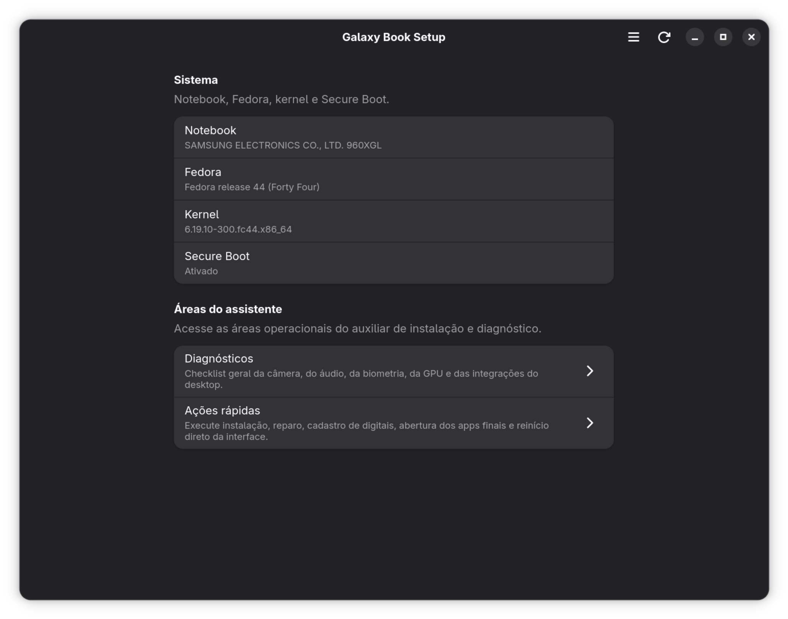
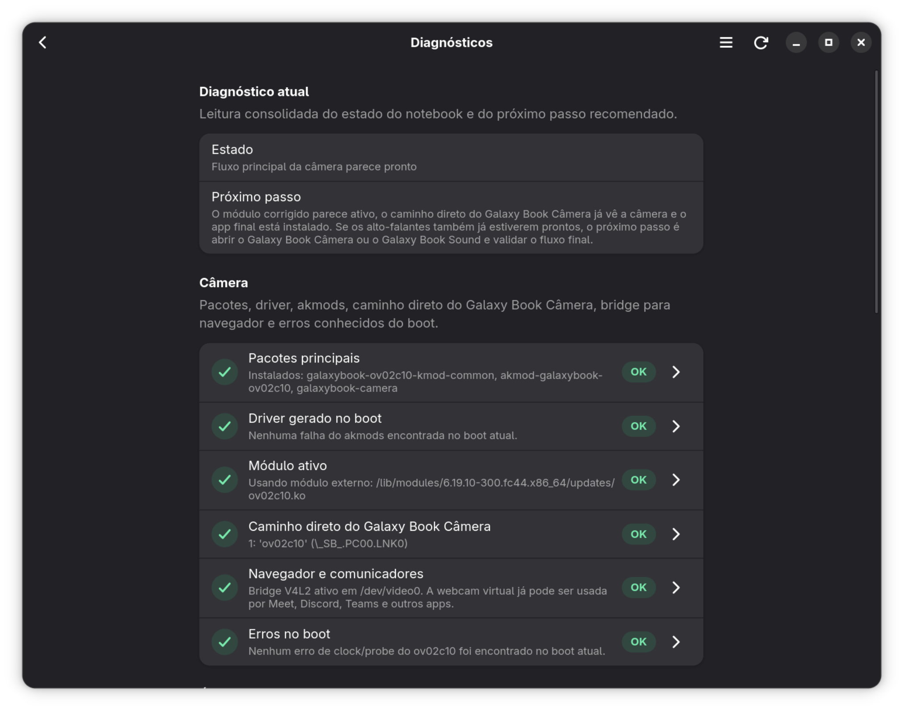
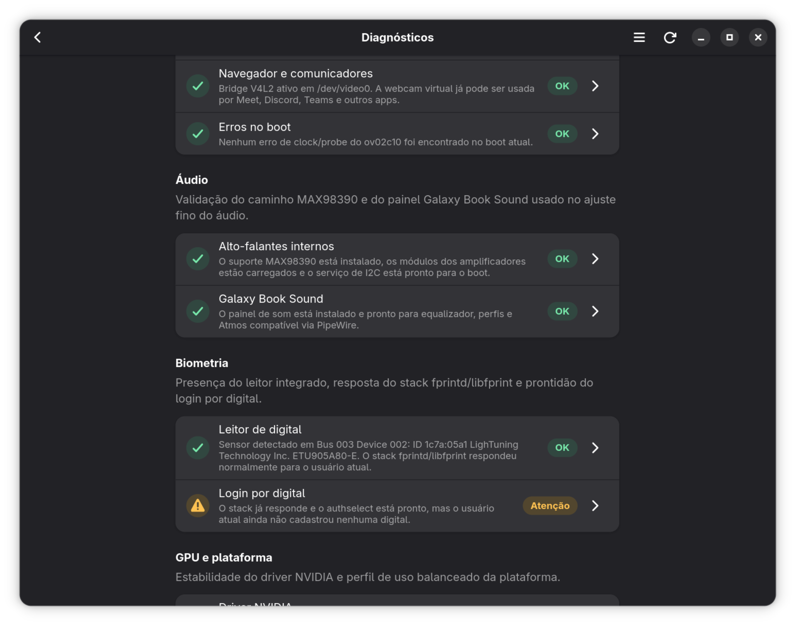
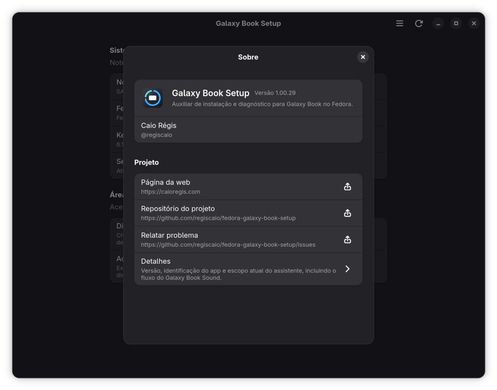

<p align="center">
  
</p>

<h1 align="center">Galaxy Book Setup</h1>

<p align="center">
  <a href="README.md">🇧🇷 Português</a> 
  <a href="README.en.md">🇺🇸 English</a> 
  <a href="README.es.md">🇪🇸 Español</a> 
  <a href="README.it.md">🇮🇹 Italiano</a>
</p>

## Instalação rápida

Para instalar o setup a partir do repositório DNF público:

```bash
sudo dnf config-manager addrepo --from-repofile=https://packages.caioregis.com/fedora/caioregis.repo
sudo dnf install galaxybook-setup
```

Com o repositório configurado, o próprio setup já consegue instalar o conjunto
principal do notebook pela ação rápida `Instalar suporte principal`, puxando o
app de câmera, o driver `OV02C10` e o suporte `MAX98390` dos alto-falantes.
Ele também consegue oferecer a instalação do `Galaxy Book Sound`, que fica
responsável por equalizador, perfis e Atmos compatível.

`Galaxy Book Setup` é um auxiliar de instalação e diagnóstico para notebooks
Samsung Galaxy Book no Fedora. A proposta do app é organizar fluxos de
configuração que normalmente acabam espalhados entre terminal, logs, pacotes
RPM e validações manuais.

O foco inicial é a **câmera interna** do Galaxy Book4 Ultra, mas o projeto já
acompanha também o fluxo dos **alto-falantes internos com MAX98390**, além de
GPU, fingerprint, perfil de plataforma e integrações gerais do sistema.

## Interface atual

### Tela inicial



### Diagnósticos



### Áudio interno



### Modal `Sobre`



## Escopo

Este app não substitui:

- o driver do kernel;
- o app final de câmera;
- ferramentas de baixo nível como `akmods`, `modinfo` ou `journalctl`.

O papel dele é funcionar como um **assistente de instalação e validação**,
mostrando o estado atual da máquina e organizando os próximos passos.

No fluxo de áudio, isso significa separar bem as responsabilidades: o
`Galaxy Book Setup` valida o caminho dos alto-falantes internos, organiza a
instalação e abre o `Galaxy Book Sound`, enquanto equalização, perfis e
`Atmos compatível` ficam no app de som.

## Relação com os outros repositórios

Este projeto trabalha junto com:

- <https://github.com/regiscaio/fedora-galaxy-book-ov02c10>
- <https://github.com/regiscaio/fedora-galaxy-book-max98390>
- <https://github.com/regiscaio/fedora-galaxy-book-camera>
- <https://github.com/regiscaio/fedora-galaxy-book-sound>

Responsabilidades:

- `fedora-galaxy-book-ov02c10`: módulo `ov02c10` empacotado para Fedora;
- `fedora-galaxy-book-max98390`: suporte empacotado aos alto-falantes internos via MAX98390;
- `fedora-galaxy-book-camera`: app de uso diário da câmera;
- `fedora-galaxy-book-sound`: app de equalizador, perfis e Atmos compatível com backend próprio em PipeWire;
- `fedora-galaxy-book-setup`: assistente de instalação, diagnóstico e fluxo.

## Recursos atuais

A versão atual do app já organiza a interface em áreas bem definidas:

- `Sistema`: resumo do notebook, Fedora, kernel e Secure Boot;
- `Diagnósticos`: checklist geral com o estado da câmera, do bridge para
  navegador, do áudio, do `Galaxy Book Sound`, do leitor de digital, da GPU,
  da chave MOK do `akmods` e das integrações do desktop, incluindo a dock do
  GNOME usada neste notebook;
- `Ações rápidas`: instalação, reparo e ajuste de prioridade do driver,
  ativação da webcam para navegador, ativação dos alto-falantes internos,
  preparação da chave do `Secure Boot` para o `MOK`, instalação e abertura do
  `Galaxy Book Sound`, reparo do stack de fingerprint, ativação do login por
  digital, abertura do cadastro de digitais, fluxo NVIDIA, perfil balanceado,
  reaplicação do perfil da dock, reboot e abertura do app da câmera.

Dentro de `Diagnósticos`, cada linha leva para uma subseção de **ações
sugeridas**. Isso permite abrir correções e validações mais relevantes para o
item selecionado sem perder a página geral de `Ações rápidas`.

O app também expõe um resumo de alertas e erros via notificações do desktop. Em
docks e extensões que suportam contador no launcher, o ícone pode mostrar a
quantidade total de itens com `Atenção` ou `Erro` nos diagnósticos.

O checklist cobre hoje:

- pacotes principais da câmera;
- geração via `akmods` e payload RPM externo para o kernel em execução e todos
  os kernels `kernel-core` instalados;
- origem do módulo `ov02c10` ativo;
- detecção da câmera no caminho direto do `libcamera` usado pelo `Galaxy Book Câmera`;
- bridge V4L2 para navegadores e comunicadores;
- erros conhecidos do boot;
- caminho MAX98390/MX98390 dos alto-falantes internos, exigindo os dois módulos
  externos por kernel, serviço persistente com resultado `success` e os quatro
  vínculos I2C finais;
- presença do `Galaxy Book Sound`;
- presença do leitor de digital integrado;
- prontidão do login por digital com `fprintd` e `authselect`;
- estado do driver NVIDIA e observação de que `nvidia-smi` é opcional;
- prontidão da chave pública do `akmods` no `MOK` quando `Secure Boot` está
  ativo, sem confundir uma chave protegida contra leitura pelo usuário com uma
  chave ausente;
- perfil de uso da plataforma, com destaque para `balanced`;
- estado do `Dash to Dock`, com checagem do perfil da dock usado neste
  notebook;
- extensões do GNOME como histórico da área de transferência, GSConnect e
  ícones na área de trabalho.

As ações rápidas não apenas copiam comandos: elas executam os fluxos principais
pela própria interface, usando privilégio administrativo quando necessário.

Hoje, as ações disponíveis incluem:

- instalar o suporte principal do notebook diretamente pelo setup, trazendo o
  app de câmera, o driver `OV02C10` e o suporte `MAX98390`;
- instalar o conjunto principal da câmera;
- reconstruir e validar o driver `OV02C10` com `akmods` para todos os kernels
  instalados;
- reconciliar o `ov02c10` por kernel, exigindo payload externo com dono RPM e
  `vermagic` correto, sem descarregar ou substituir ao vivo um módulo ocupado;
- ajustar a prioridade do driver corrigido somente depois de validar todos os
  replacements. Os helpers do pacote removem apenas shadows e overrides
  legados reconhecidos, executam `depmod`, reconstroem cada initramfs e conferem
  com `lsinitrd` que a imagem contém o módulo de
  `extra/galaxybook-ov02c10`;
- ativar a câmera para navegador via `icamerasrc`, `v4l2-relayd` e
  `v4l2loopback`, preservando symlinks e configurações administrativas ou de
  vendor, mantendo o acesso direto do `libcamera` e exigindo uma webcam virtual
  com capacidade de captura antes de concluir. Se o OV02C10 estiver presente
  mas sem driver, o Setup indica o diagnóstico do sensor antes de acionar o relay.
  Reaplicar a configuração preserva um relay ativo com captura disponível. Se a regra administrativa
  legada `/etc/udev/rules.d/90-hide-ipu6-v4l2.rules` existir, o setup a preserva
  e interrompe a ação antes de recarregar o UDev ou serviços; revise-a e, se
  apropriado, remova-a manualmente como administrador antes de executar a ação
  novamente;
- ativar o suporte aos alto-falantes internos via `MAX98390`, gerando os dois
  módulos empacotados por kernel, validando dono RPM e habilitando o serviço de
  I2C que só conclui com os quatro amplificadores vinculados;
- preparar a chave do `Secure Boot` para o `akmods`, gerando a chave local,
  criando o pedido de importação no `MOK` e deixando o reboot pronto para o
  `Enroll MOK` no boot;
- instalar o `Galaxy Book Sound` para aplicar equalização e Atmos compatível na
  sessão via PipeWire;
- reinstalar o stack de fingerprint com `fprintd` e `libfprint`;
- habilitar `with-fingerprint` no `authselect`;
- abrir diretamente o cadastro de digitais nas configurações de usuários;
- instalar ou reparar o suporte NVIDIA;
- aplicar o perfil `balanced` da plataforma;
- reaplicar o perfil da dock do GNOME usado neste notebook, reativando o
  `Dash to Dock` e restaurando o comportamento esperado da dock inferior
  auto-ocultável;
- reiniciar normalmente, respeitando inhibitors do sistema e sem interromper
  builds de módulos em andamento;
- abrir o `Galaxy Book Câmera`;
- abrir o `Galaxy Book Sound`.

## Câmera após atualização de kernel

Depois de uma atualização de kernel, o boot pode tentar carregar o `ov02c10`
antes de o `akmods` terminar de gerar o módulo corrigido para esse kernel. Nesse
estado, o log registra:

```text
external clock 26000000 is not supported
probe with driver ov02c10 failed with error -22
```

Em versões antigas do driver, esse reparo podia deixar um
`/lib/modules/<kernel>/updates/ov02c10.ko` manual e sem dono RPM. Isso recuperava
a prioridade do módulo, mas podia gerar avisos de `depmod` em upgrades
posteriores. O fluxo atual enumera o kernel em execução e todos os pacotes
`kernel-core` instalados. Para cada versão, ele instala os arquivos de
desenvolvimento necessários, força o `akmods` e exige o pacote
`kmod-galaxybook-ov02c10-<kernel>` com payload em
`extra/galaxybook-ov02c10`, dono RPM e `vermagic` correspondente.

Somente depois de todos os replacements estarem válidos, os helpers mantidos
pelo próprio pacote do driver migram configurações legadas de conteúdo
conhecido, removem overrides órfãos reconhecidos, executam `depmod` e reconstroem
o initramfs de cada kernel. O finalizador só retorna sucesso depois que
`modinfo` resolve o módulo externo e `lsinitrd` confirma a cópia correta na
imagem; ausência, cópia in-tree ou falha do `dracut` interrompem a ação. Esse
sucesso privilegiado publica uma atestação `root:root` por kernel com
fingerprints fortes do initramfs e do payload. O diagnóstico gráfico compara a
atestação com os metadados atuais — e a invalida se qualquer arquivo mudar —
sem tentar ler o initramfs `0600`; a atestação não substitui a inspeção de
conteúdo feita pelo finalizador.

O diagnóstico executa `cam` no ambiente normal do sistema. O tuning do sensor é
responsabilidade do pacote da câmera no lookup global do libcamera em
`/usr/share/libcamera/ipa/simple/ov02c10.yaml`, não de uma variável de ambiente
privada do setup.

Há um limite físico importante: `cam -l` e o grafo registrado provam enumeração,
não estabilidade da captura. Um ensaio anterior com `cam -C30` terminou sem
frames e registrou `Frame sync`; já o smoke físico final do app, no boot atual,
capturou `1920x1092` e validou foto e vídeo. Isso comprova que o pipeline pode
funcionar, mas não valida a sequência de PLL para 26 MHz nem a estabilidade
entre cold boot, suspensão e novo probe. Reconciliação, initramfs e sensor
listado indicam prontidão de registro/boot, não garantia de captura estável.

Mesmo que `modinfo -n ov02c10` passe a apontar para o módulo corrigido depois
que o `akmods` termina, o grafo IPU6 daquele boot já pode ter sido criado sem o
sensor, fazendo `cam -l` não listar a câmera interna.

O diagnóstico agora trata esse caso como falha do caminho direto da câmera e
sugere `Ajustar prioridade do driver` seguido de reboot. A ação prepara todos os
kernels, mas não tenta descarregar um módulo ocupado nem finge uma troca ao vivo.
O reboot recria o grafo de mídia já com o driver correto disponível desde o
início do boot.

Durante toda a reconciliação, inclusive a transação DNF iniciada pelo Setup, o
fluxo mantém um mutex global exclusivo em
`/run/lock/galaxybook-kmod-lifecycle.lock`. O Setup, os workers OV02C10 e
MAX98390 e a manutenção NVIDIA herdam e revalidam o mesmo descritor; assim,
`akmods`, limpeza, `depmod`, `dracut` e publicação de estado não se sobrepõem
entre drivers. A ordem única é mutex global, mutex privado do driver e lock de
leitura do RPM quando aplicável. O coordenador abre primeiro um inhibitor
bloqueante de shutdown, suspensão e idle e só depois adquire o mutex; assim,
nenhum descritor de lock precisa atravessar o `systemd-inhibit`, que fecha
descritores adicionais antes de iniciar o filho. O mesmo shell mantém o mutex
do DNF até a reconciliação final. O inventário inicial e as validações antes e
depois dos finalizadores usam snapshots estáveis sob o lock RPM compartilhado.
O coordenador libera esse lock antes de chamar cada família, permitindo que o
finalizador preserve a ordem `global → privado → RPM`, e o readquire depois
para repetir dono, caminho, `vermagic`, assinatura e resolução dos módulos até
o reconhecimento final. O botão de reboot só é liberado depois que
não há build ativo; o comando de reboot é o normal do `systemd`, portanto
respeita os demais inhibitors do sistema.

A ação NVIDIA usa o mesmo protocolo: identifica e valida estritamente o kernel
em execução, executa `depmod -a <kernel>` e `dracut --force --kver <kernel>` sob
mutex global e lock RPM compartilhado, sem depender do kernel implícito desses
comandos.

A preparação da chave MOK também mantém esse mutex desde a inspeção do par de
chaves até a publicação final do certificado e do marcador. Assim, o `akmods`
não pode assinar um módulo enquanto sua identidade criptográfica está sendo
gerada ou publicada.

## Alto-falantes após atualização de kernel

O `MAX98390` não usa mais uma cópia manual em `/updates`. O setup força o akmod
para cada kernel instalado e exige que
`snd-hda-scodec-max98390` e `snd-hda-scodec-max98390-i2c` resolvam para
`extra/galaxybook-max98390` e pertençam ao pacote kmod específico daquele
kernel. Somente depois de validar ambos os replacements em todos os kernels, o
setup chama o finalizador síncrono do próprio pacote MAX98390 por kernel. Ele
preserva as cópias antigas em `/updates` e executa `depmod` sob o mesmo lock
do worker. A reconciliação só termina quando `modinfo` seleciona, em `/extra`,
os dois módulos íntegros do RPM específico daquele kernel.

No kernel em execução, o serviço empacotado é a única autoridade de boot para
o carregamento e a criação dos clientes I2C. O diagnóstico aceita tanto IDs
ACPI `MAX98390` quanto `MX98390`, exige `ActiveState=active`, `Result=success` e
os quatro vínculos finais com o driver. Um `EPROBE_DEFER` transitório não é
tratado como falha quando os quatro vínculos aparecem ao final.

## Secure Boot e MOK

O modo administrativo `reconcile-kmods prepare-all` prepara os drivers em disco para todos os kernels. Exige Secure Boot ativo, chave inscrita e filas de operações MOK vazias. Não reinicia, não ativa o serviço de áudio e não comprova o funcionamento físico.

A partir da 1.00.49, a reconciliação publica uma cópia de diagnóstico do certificado público e um marcador de identidade somente depois de comprovar que a chave já está inscrita. Isso não altera o MOK nem as permissões da chave original. Para atualizar só o diagnóstico, use `sudo /usr/libexec/galaxybook-setup/prepare-secure-boot-key --publish-enrolled`. Se a inscrição não for confirmada, o comando falha sem iniciar uma importação; não é preciso definir senha ou reiniciar para publicar uma identidade já inscrita.

Se alguma ação rápida falhar com algo como:

```text
modprobe: ERROR: could not insert 'ov02c10': Key was rejected by service
modprobe: ERROR: could not insert 'snd_hda_scodec_max98390': Key was rejected by service
```

o problema não é compilação do módulo em si. Esse erro significa que o kernel
continuou com `Secure Boot` ativo, mas a chave usada para assinar o módulo
ainda não foi aceita no `MOK`.

O caminho esperado é:

```bash
mokutil --test-key /etc/pki/akmods/certs/public_key.der
sudo mokutil --import /etc/pki/akmods/certs/public_key.der
```

O setup considera a chave inscrita quando `mokutil --test-key` termina com
status zero ou quando a impressão digital SHA-1 exata do certificado atual
aparece em `mokutil --list-enrolled`. Uma mensagem textual isolada não é usada
como prova, porque pode vir de uma falha, locale ou versão diferente.

O próprio `Galaxy Book Setup` agora expõe a ação rápida
`Preparar chave do Secure Boot`, que:

- gera a chave local do `akmods` com `kmodgenca` quando necessário;
- pede uma senha temporária do `MOK` na interface;
- cria o pedido de importação no `mokutil`;
- atualiza o diagnóstico para mostrar se a chave ficou pronta, pendente de
  reboot ou ainda precisa de atenção.

O processo gráfico não precisa ler a chave privada, que normalmente fica
protegida para `root:akmods`. Quando essa leitura é proibida, o diagnóstico
retorna estado desconhecido em vez de afirmar incorretamente que a chave está
ausente. Ele usa o certificado público, um módulo externo assinado já aceito ou
o pedido exato listado por `mokutil --list-new` para reconhecer os estados que
podem ser comprovados.
O helper privilegiado preserva os diretórios de certificado e chave privada
como `root:akmods` com modo `0750`. Ele aceita os symlinks internos criados pelo
`kmodgenca` somente quando link, hierarquia e alvo passam nas verificações de
confinamento, dono e permissões; links quebrados ou que escapem desses
diretórios são recusados. O estado público grava cada artefato atomicamente,
como arquivos regulares `root:root` `0644` com um único link: uma cópia do
certificado DER público e sua identidade versionada — CN para apresentação,
fingerprint SHA-1 para correlação exata com MOK e número de série X.509 para
correlação exata com `modinfo -F sig_key`. A GUI cruza os dois arquivos e o
módulo assinado; uma publicação interrompida ou divergente falha de forma
fechada e converge na próxima execução do helper. Nenhuma chave privada é
copiada para o estado do app.

Para não confundir um payload recém-instalado no disco com um módulo antigo já
carregado, o diagnóstico compara primeiro a seção GNU build-id, byte a byte.
`srcversion` só é usado como fallback estrito quando nem o kernel nem o módulo
expõem build-id.

Depois disso:

1. reinicie o notebook;
2. entre em `Enroll MOK` na tela azul do boot;
3. confirme a senha definida no `mokutil --import`;
4. volte ao Fedora, atualize o diagnóstico e execute a ação rápida novamente se
   a validação ao vivo ainda estiver pendente.

Os payloads assinados podem ser gerados e validados em disco antes da inscrição
da chave. Se o pedido exato estiver pendente, o setup habilita as units, adia
somente a validação MAX98390 ao vivo — que o kernel ainda rejeitaria — e libera o
reboot necessário para concluir o Enroll MOK. Sem pedido pendente comprovado, a
ação falha explicitamente e não sugere um reboot como reparo do driver; o botão
de reboot genérico continua disponível quando nenhum build do akmods está ativo.

## Instalação para usuários

### Via repositório DNF público

O caminho recomendado para usuários finais é:

```bash
sudo dnf config-manager addrepo --from-repofile=https://packages.caioregis.com/fedora/caioregis.repo
sudo dnf install galaxybook-setup
```

Depois disso, dentro do próprio app:

1. abra `Ações rápidas`;
2. execute `Instalar suporte principal`;
3. use as ações específicas se câmera, áudio, NVIDIA ou a dock ainda
   precisarem de ajuste.

### Via RPM local

O projeto também pode ser empacotado localmente:

```bash
make rpm
```

Depois, o RPM pode ser instalado com:

```bash
sudo dnf install /caminho/para/galaxybook-setup-*.rpm
```

## Build

Dependências de build no Fedora:

```bash
sudo dnf install make podman cargo rust pkgconf-pkg-config gtk4-devel libadwaita-devel
```

O `Makefile` usa um container rootless com `podman` quando o host não tiver o
toolchain gráfico completo; `make` e `podman` também são necessários para gerar
os artefatos RPM reproduzíveis.

Em um checkout com histórico completo, Cargo e RPM usam `scripts/package-version.sh`.
O script registra commits que só revisam o RPM: `1.00.48-2` mantém o aplicativo em
`1.00.48`. O próximo commit normal gera `1.00.49-1`, sem ajustes no ambiente.

Comandos principais:

```bash
make build
make test
make dist
make srpm
make rpm
```

Para instalar o launcher local de desenvolvimento:

```bash
make install-local
```

## Empacotamento

Arquivos relevantes:

- spec RPM: [`packaging/fedora/galaxybook-setup.spec`](packaging/fedora/galaxybook-setup.spec)
- launcher: [`data/com.caioregis.GalaxyBookSetup.desktop`](data/com.caioregis.GalaxyBookSetup.desktop)
- metadados AppStream: [`data/com.caioregis.GalaxyBookSetup.metainfo.xml`](data/com.caioregis.GalaxyBookSetup.metainfo.xml)

O RPM usa dependências fracas (`Recommends` e `Suggests`) para apontar os
pacotes mais importantes do fluxo:

- `galaxybook-ov02c10-kmod-common`
- `akmod-galaxybook-ov02c10`
- `kmod-galaxybook-ov02c10`
- `akmod-galaxybook-max98390`
- `galaxybook-max98390-kmod-common`
- `kmod-galaxybook-max98390`
- `galaxybook-camera >= 1.00.43`
- `galaxybook-sound >= 1.00.18` (opcional)

Os mínimos funcionais do ciclo atual são `galaxybook-ov02c10 >= 1.00.25` para
a família OV02C10, `galaxybook-max98390 >= 1.00.12` para a família MAX98390 e
`galaxybook-camera >= 1.00.43`. A ação opcional de som instala
`galaxybook-sound >= 1.00.18`. Atualize o Setup e as famílias completas de
drivers na mesma transação para não misturar contratos de lifecycle antigos e
novos.

Ao migrar de `galaxybook-setup <= 1.00.47`, não inicie a primeira atualização
pela interface antiga: um shell privilegiado que já esteja em execução não pode
passar a participar retroativamente do novo mutex. Feche todas as janelas do
Setup, aguarde qualquer ação em andamento terminar e atualize primeiro apenas o
coordenador, sem dependências fracas:

```bash
sudo dnf --setopt=install_weak_deps=False --refresh upgrade galaxybook-setup
```

Os requisitos condicionais atualizam também qualquer pacote `*-kmod-common` já
instalado para o contrato compatível, mas não instalam uma família ausente.
Depois, reabra o Setup `1.00.48` ou mais novo e use sua ação **Atualizar
pacotes**; essa segunda etapa mantém o inhibitor e o mutex global desde o DNF
dos membros restantes até a reconciliação final.

Isso permite que o app seja instalado mesmo antes do setup completo da câmera,
o que é desejável para um auxiliar de instalação.

## Roadmap

Próximas evoluções previstas:

- checagens gerais de compatibilidade do Galaxy Book com Fedora;
- mais fluxos assistidos para integrações do ambiente GNOME e periféricos do notebook;
- aprofundar as leituras de fingerprint com foco em validação pós-suspensão e cenários de sensor ocupado.

## Licença

Este projeto é distribuído sob a licença **GPL-3.0-only**. Veja o arquivo
[LICENSE](LICENSE).
